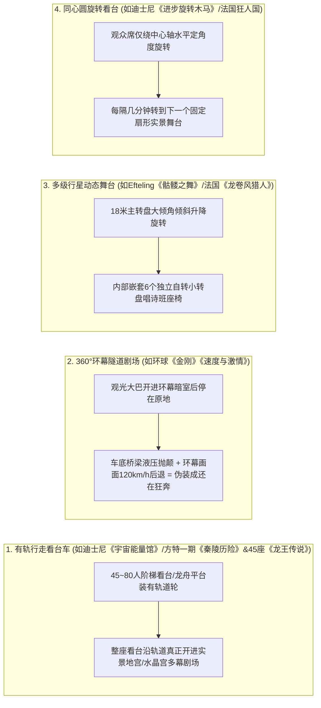
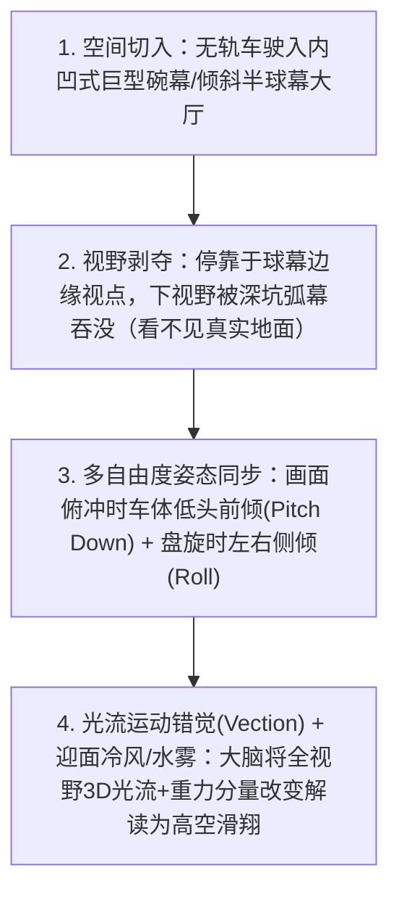

# Dark Ride 与暗黑剧场：六大核心工程机制深度辨析专篇

> [!TIP]
> **关联阅读：全景机制百科与全球项目全集**
> 如需查阅五大行进式物理门类、六大剧场类别以及全球 69 座主题乐园的全量穷举与 4K POV / 开灯视频库，请点击跳转：[dark_ride_mechanisms_guide.md](file:///Users/xtxsinan/.gemini/antigravity/brain/92769dbb-44e8-454f-9161-0fd94b9de02d/dark_ride_mechanisms_guide.md)。

在主题乐园游乐设备工程（Ride Engineering）中，许多项目由于在黑暗环境中隐藏了支撑结构与导轨，极易让游客甚至从业者产生机制混淆（例如把地面支撑的工业机械臂误认为顶部悬挂系统，把无轨多自由度球幕车误认为静态无轨车，或把停在原地动感桥上的环幕大巴误认为高速行进车）。

本文档专门针对行业中最易混淆的 **六大组（共 19 种）硬件机制** 进行底层机械拓扑、运动学自由度（DOF）与前庭欺骗原理的硬核对比。

## 📑 专篇目录导航（Table of Contents）

- **⚖️ [【辨析一】空中/机械臂类四大机制辨析](#dist-1)**
  - `3.3 顶部悬挂动感座舱` vs. `1.1.3.1 轨道工业机械臂 (KUKA)` vs. `3.4 悬挂式受控动力过山车` vs. `1.1.3.2 高速轨道机器人平台`
- **⚖️ [【辨析二】地面动感小车三大机制辨析（含方特《秦俑地宫》定位）](#dist-2)**
  - `1.1.2.1 车载 6-DOF 多媒体动感车 (SCOOP)` vs. `1.1.2.3 迪士尼液压越野吉普 (EMV)` vs. `1.1.1.4 普通有轨车 + 局部轨道动感跳台`
- **⚖️ [【辨析三】高自由度平面/水面导引三大机制辨析](#dist-3)**
  - `2.1/2.2 无轨 AGV/LPS 系统` vs. `5.1.3.1 水下电磁导引可控船` vs. `1.1.4.1 高速槽轨测试车 (Slot Car)`
- **⚖️ [【辨析四】“车动还是剧场动？”——四大剧场/行进跨界机制辨析](#dist-4)**
  - `T3.2 有轨行走看台车` vs. `T4.1 360° 环幕隧道车载剧场` vs. `T3.1 多级行星动态旋转舞台` vs. `T3.3 同心圆旋转看台剧场`
- **⚖️ [【辨析五】悬挂式球幕飞行影院（Flying Theater）的四大机械送入构型辨析](#dist-5)**
  - `T1.1 顶置钢缆垂直提拉` vs. `T1.2 多层楼板水平平推` vs. `T1.3 巨型钢架整体拉升` vs. `T1.4 平地入座 90° 整体翻转竖立`
- **⚖️ [【辨析六】方特《神画》《千古风华》专项拆解——地面无轨动感车如何实现《千里江山图》球幕飞行影院效果？](#dist-6)**
  - `┣━━ 🔹 6.1 硬件本质：无轨 AGV 底盘 + 车载多自由度动感平台`
  - `┗━━ 🔹 6.2 《千里江山图》段实现“伪球幕飞行影院”的四重工程欺骗机制`

---

## ⚖️ 【辨析一】空中/机械臂类四大机制辨析
**【顶部悬挂动感座舱】vs.【轨道工业机械臂 (KUKA)】vs.【悬挂式受控动力过山车】vs.【高速轨道机器人平台】**

很多游客坐完环球《哈利·波特与禁忌之旅》或中国方特《烈焰风云》后，因为双脚悬空且在半空中翻仰，常误以为它们是同一种设备。实际上，这四者在机械工程上截然不同：

### 四大机制硬核参数对比表

| 工程维度 | 1. 顶部悬挂动感座舱 (Suspended Motion Cabin) | 2. 轨道工业机械臂 (Robotic Arm / KUKA Robocoaster) | 3. 悬挂式受控动力过山车 (Inverted Powered Coaster) | 4. 高速轨道机器人平台 (Robotic Motion Vehicle) |
| :--- | :--- | :--- | :--- | :--- |
| **轨道真实位置** | **天花板上方**（Overhead Track） | **地面下方**（Floor Track，少数概念可倒装，但环球全部采用地面支撑配重底盘） | **天花板上方**（Overhead Coaster Track） | **地面下方**（Floor High-Speed Track） |
| **核心机械构型** | **并联万向节/钟摆构型**：顶部回转盘 + 俯仰/横滚液压缸，无折叠大小臂 | **串联六轴开链机器人构型**：底座J1 + 大臂J2 + 小臂J3 + 三轴手腕J4~J6 | **刚性吊杆 + 单轴伺服电机**：仅靠轨道本身的高低坡度改变垂直位置 | **高速底盘 + 多自由度机械摇臂**：融合过山车轮架与机器人关节 |
| **空间三维位移能力 (X/Y/Z)** | **无独立垂直/横向伸缩能力**：座舱距天花板高度固定，只能沿轨道中心线走 | **极强**：大小臂伸展可让座舱在垂直方向升降数米、横向偏离轨道中心线伸向布景 | **轨道决定**：座舱本身不能相对于轮架升降，完全靠轨道爬升俯冲实现高低变化 | **中等偏强**：机械臂可在高速滑行中将座舱向外侧甩出或向上抬起 |
| **姿态翻转极限 (Pitch/Roll/Yaw)** | 水平 360° 旋转 + 前后俯仰约 ±45°~90°（呈秋千摆动感） | 水平旋转 + **高达 ±110° 以上的仰躺（近乎背朝地平躺）与倒挂俯冲感** | 仅水平 360° 旋转（俯仰与横滚完全取决于轨道倾角 Banking） | 水平 360° 高速旋转 + 大角度俯仰与侧倾翻滚 |
| **走行速度范围** | 慢~中速（约 0.8 ~ 3 m/s） | 恒定慢速（底盘约 0.6 ~ 1.2 m/s，快动作全靠机械臂挥舞产生） | **极宽调速比**（室内可 0.5 m/s 悬停，室外可达 35~50 km/h） | **高速**（底盘直接冲刺并带急停甩尾） |
| **代表制造商** | 华强方特、SetPoint、Vekoma | KUKA / Robocoaster / Dynamic | Mack Rides | Dynamic Attractions |
| **典型代表作** | 中国方特《烈焰风云》 | 环球《哈利·波特与禁忌之旅》《Monsters Unchained》 | Europa-Park《Arthur》、迪拜 Motiongate《驯龙高手》 | 阿布扎比华纳《蝙蝠侠：暗夜飞行》 |

[⬆️ 返回目录](#toc)

---

## ⚖️ 【辨析二】地面动感小车三大机制辨析
**【车载 6-DOF 多媒体动感车 (SCOOP)】vs.【迪士尼液压越野吉普 (EMV)】vs.【有轨小车 + 轨道段动感跳台】**

同样是“坐在地面轨道车上经历颠簸摇晃”，工程实现路径与成本相差数倍：

| 工程维度 | 1. 车载 6-DOF 多媒体动感车 (SCOOP System) | 2. 迪士尼重型液压越野车 (EMV System) | 3. 普通有轨车 + 局部轨道动感跳台 |
| :--- | :--- | :--- | :--- |
| **动感机构装在哪？** | **装在每一辆车上**：每台车底盘上都背着一套 6 自由度 Stewart 液压/电动平台 + 360° 回转盘 | **装在每一辆车上**：每台车底盘内置高压液压蓄能器与大行程俯仰/横滚/升降油缸 | **装在固定房间的地板下**：小车本身是死板的普通铁皮车，但某个房间的一截铁轨架在地面液压平台上 |
| **是否有 360° 水平自转？** | **有（核心特征）**：靠快速自转在十几个 3D 屏幕与实景墙之间无缝切换视线 | **无**：车头始终朝向轨道前方（无法自转），专注模拟真实汽车驾驶路感 | **无（或仅简单转盘）** |
| **视觉载体匹配** | **3D 巨幕为主 + 实景衔接**：必须戴 3D 眼镜，配合动态透视矫正算法（Squinching） | **100% 纯实景 + 机械人偶**：不戴眼镜，全靠真实墓道、吊桥、巨石与大型机械怪兽 | **局部弧幕/实景房间**：仅在驶上跳台的那几十秒内产生弹跳体感 |
| **典型代表作** | 环球《蜘蛛侠》《变形金刚》《北京侏罗纪》；吉隆坡 SkyWorlds《猩球崛起》；**方特《女娲补天》《恐龙危机》《魔法城堡》** | 加州/东京迪士尼《印第安纳琼斯冒险旅程》；奥兰多迪士尼《恐龙 (DINOSAUR)》；**方特梦幻王国《秦俑地宫》(青岛) /《秦陵历险》(芜湖/厦门/株洲 12座探险吉普版)** | Europa-Park《斯诺里之旅 (Snorri Touren)》；东京迪士尼《小熊维尼（跳跳虎弹跳地板段）》 |

[⬆️ 返回目录](#toc)

---

## ⚖️ 【辨析三】高自由度平面/水面导引三大机制辨析
**【无轨 AGV/LPS 系统】vs.【水下电磁导引可控船】vs.【高速槽轨测试车 (Slot Car)】**

| 工程维度 | 1. 无轨导引系统 (Trackless AGV / LPS) | 2. 水下电磁导引可控船 (Magnetically Guided Boat) | 3. 高速槽轨测试车 (High-Speed Slot Car) |
| :--- | :--- | :--- | :--- |
| **物理约束方式** | **零物理轨道**：平地自由走行，靠地板 RFID/磁钉/Wi-Fi/激光雷达虚拟导航 | **水下隐形钢轨**：船浮在水面，但水底深处有刚性变轨网络与直线电机滑块牵引船底立柱 | **地面深槽导轨**：类似放大版四驱车，地面开槽内嵌导向轨与三相高压供电母线 |
| **动力来源** | **车载锂电池/超级电容**（必须在夜间或上下客间隙无线充电，限制了最高车速与载重） | **水下外部电网直供（LSM 直线电机 + 伺服电机）**，功率无穷大，可驱动 30 人巨船 | **沟槽高压母线实时取电 + 250马力车载电机**，支持百公里加速 |
| **独特运动绝技** | 多车交叉编队群舞、真随机分道、差速轮模拟冰面打滑漂移 | 水面 360° 原地自转、横向螃蟹步平移、急停倒退、水下变轨逆向冲坡 | 室内 5 km/h 慢速看戏 $\rightarrow$ 室外瞬间飙至 105 km/h 双车并排竞速 |
| **典型代表作** | 迪士尼《迷离大宅》《美女与野兽》《疯狂动物城》；**中国方特《神画》《千古风华》**；Efteling《Symbolica》；吉隆坡 SkyWorlds《冰川时代》 | 上海迪士尼《加勒比海盗——沉落宝藏之战》 | 迪士尼《汽车总动员：急速飞驰》《地心探险之旅》《测试赛道》 |

[⬆️ 返回目录](#toc)

---

## ⚖️ 【辨析四】“车动还是剧场动？”——四大剧场/行进跨界机制辨析
**【有轨行走看台车】vs.【360° 环幕隧道车载剧场】vs.【多级行星动态旋转舞台】vs.【同心圆旋转看台剧场】**

这四种机制经常让游客搞不清“我到底是在坐车，还是在坐剧场看台？”：

[⬆️ 返回目录](#toc)

---

## ⚖️ 【辨析五】悬挂式球幕飞行影院（Flying Theater）的四大机械送入构型辨析

全球乐园中叫《飞越XX》的球幕飞行影院看似体验相似，但其背后把数百名游客送入球幕球心的**重型机械结构**有 4 代截然不同的工程流派：

| 构型流派 | 机械送入原理 | 优势与局限 | 典型代表项目 |
| :--- | :--- | :--- | :--- |
| **1. 顶置钢缆悬臂提拉式 (Disney Soarin' 型)** | 游客在平地分 3 排入座；启动后，顶部巨型桁架通过钢缆将 3 排吊篮像提木偶一样**从地面向上垂直提拉升空**，拼成上中下三层悬在球幕前。 | 单层平地入座无需爬楼；但顶部桁架极其笨重，前排升起时偶有看到上排脚尖。 | 全球迪士尼《翱翔·飞越地平线 (Soarin')》 |
| **2. 多层楼板水平平推式 (Brogent i-Ride / 方特伴你飞翔型)** | 预演排队直接分流到 1、2、3 层楼板；启动后护栏收起，每层楼背后的液压平行四连杆臂将整排座椅**水平向前推出 3~4 米**伸进球幕。 | 机械结构高度模块化、可靠性极高、座椅独立 6-DOF 响应快；但游客需爬楼梯分层。 | Europa-Park《Voletarium》；方特《伴你飞翔》；华侨城《飞越美利坚》；阿布扎比华纳《绿灯侠》 |
| **3. 巨型多层钢架整体垂直拉升式 (方特飞越极限型)** | 游客在底层多层框架入座；启动后，重达数十吨的巨型钢铁立体笼架依靠配重与卷扬机，将上百名游客**整体垂直拉升十余米并向前推入球幕**。 | 机械运动过程本身极具工业震撼感；但设备自重极大、能耗与土建要求高。 | 中国方特《飞越极限》 |
| **4. 水平入座 90° 整体翻转式 / 180° 旋转切入式 (Intamin / Brogent m-Ride 型)** | 游客在同一个水平面上快速入座，随后**整块百吨重的地板向上 90° 翻转竖立**（瞬间把多排平地座位变成垂直多层悬空吊椅）；或座椅旋转 180° 切入球幕。 | 彻底免去多层爬楼，上下客速度最快；翻转瞬间的失重感极强。 | **吉隆坡云顶天城世界《独立日：绝地反击》**；法国 Futuroscope《L'Extraordinaire Voyage》；乐高乐园《Masters of Flight》 |

[⬆️ 返回目录](#toc)

---

## ⚖️ 【辨析六】方特《神画》《千古风华》专项拆解——地面无轨动感车如何在《千里江山图》段实现“球幕飞行影院”效果？

许多体验过方特《神画》（太原、绵阳、鹰潭东方神画）、《千古风华》（宁波、荆州东方神画、邯郸国色春秋）或《石窟奇遇》（资阳国色春秋）的游客都会产生一个强烈的疑问：**“我明明坐的是在平地上跑的无轨小车、双脚并没有像《伴你飞翔》那样悬空吊起，为什么到了《千里江山图》高潮段，却有极强的凌空飞越悬崖、俯冲江面的球幕飞行影院体感？这辆车到底有没有多自由度？”**

### ┣━━ 🔹 1. 硬件本质：无轨 AGV 底盘 + 车载多自由度动感平台（Trackless + Onboard Multi-DOF Motion Base）
《神画》与《千古风华》采用的绝非普通死板的平地无轨观光车，而是华强方特自主研发的**“大型无轨道球幕动感游览车系统”**。其车体由上下两层机构叠加而成：
* **下层（无轨全向走行底盘）**：采用车载电池供电与埋地信标/光学寻迹导航，可在平坦地面上多车编组自由穿行、分道进出不同画室、原地 360° 偏航旋转（Yaw）。
* **上层（车载多自由度伺服动感平台）**：底盘与乘客座舱之间装有**多自由度电动/液压伺服作动器（具备前后俯仰 Pitch、左右横滚 Roll、垂直微升降 Heave 自由度）**。

### ┗━━ 🔹 2. 《千里江山图》段实现“伪球幕飞行影院”的四重工程欺骗机制

1. **第一重（空间包裹与下视野剥夺）**：
   在前几幕穿过《洛神赋图》《清明上河图》的立体实景与长卷走廊后，多辆无轨车编队驶入最后一个巨大的**内凹式倾斜半球幕/碗幕（Tilted Dome / Bowl Screen）大厅**，并并排停靠在球幕中心视点（Sweet Spot）的平台边缘。由于球幕不仅向上包裹天顶，更向下延伸至车头前下方的深渊，游客的**下视野（Lower FOV）被画面完全填满**，彻底失去了地面水平参照物。
2. **第二重（车载多自由度姿态倾角欺骗前庭）**：
   虽然车轮停在地面不动，但车载多自由度平台开始随航拍镜头大角度运动：
   * 当镜头从青绿山巅向下俯冲（Dive）时，车载平台同步**大角度向前低头俯倾（Pitch Down，约 15°~20°）**，人体重心前移产生下坠感；
   * 当镜头绕险峰急转盘旋（Banking Turn）时，车载平台同步**左右横滚侧倾（Roll）并配合底盘偏航微转（Yaw）**；
   * 当镜头冲上云霄拉升时，车载平台**向后仰起（Pitch Up）并顶升（Heave）**，产生推背超重感。
3. **第三重（3D 全视野光流自我运动错觉 Vection）**：
   佩戴 3D 眼镜后，整个超过 180° 的立体视野被第一人称航拍高速推进的《千里江山图》三维山河占据。神经科学研究表明，当人类视网膜边缘视野（Peripheral Vision）被一致的高速光流填满时，即使身体处于原位，视觉皮层也会在 0.5 秒内强制欺骗前庭系统产生强烈的**“自我飞行错觉（Vection）”**。
4. **第四重（4D 迎面风幕与水雾闭环）**：
   球幕下方隐藏的大功率风机随俯冲速度同步吹出强劲迎面冷风，掠过江面瀑布时喷出细密水雾，从而在不把座椅吊到半空的前提下，完美复刻了悬挂式球幕飞行影院 85% 以上的凌空飞翔体感！

