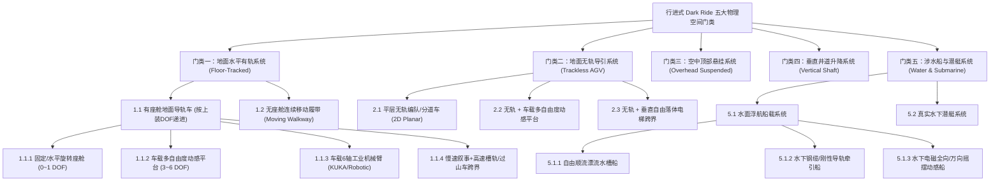

# 全球主题乐园 Dark Ride（黑暗乘骑）与暗黑剧场机制穷举全书

> [!TIP]
> **关联阅读：核心工程辨析专篇**
> 关于最易混淆的硬件机制对比（如：**方特《神画》《千古风华》无轨多自由度车如何实现《千里江山图》球幕飞行影院效果**、**顶部悬挂动感座舱 vs. KUKA 轨道工业机械臂**、**6-DOF SCOOP 车 vs. 迪士尼 EMV 越野车**、**无轨车 vs. 水下电磁船**、**球幕飞行影院四大机械构型**），请查阅独立专篇文档：[dark_ride_engineering_distinctions.md](file:///Users/xtxsinan/.gemini/antigravity/brain/92769dbb-44e8-454f-9161-0fd94b9de02d/dark_ride_engineering_distinctions.md)。

本文档将全球暗黑游乐项目拆解为 **第一部分：行进式 Dark Ride 的 5 大物理门类（采用 2~4 层可变深度逻辑树，共 29 个底层机制亚种）**、**第二部分：暗黑剧场与动感平台的 6 大硬件类别（21 个亚种）**、**第三部分：全球六大乐园体系（迪士尼、环球、中国方特、迪拜与阿布扎比、吉隆坡云顶 SkyWorlds、欧洲四大标杆乐园）全项目分类总表** 以及 **第四部分：视觉与交互机制矩阵**。

> [!IMPORTANT]
> **第一部分“真·行进式 Dark Ride”的严格准入边界与分类逻辑**
> 1. **必须具备路线空间位移（Spatial Progression）**：载具必须带着游客在不同叙事房间/场景之间发生真实的路线行进。因此，**原地固定基座的 KUKA 机械臂**（如 Futuroscope《与机器人共舞》、乐高《Power Builder》）与 **室内暗黑 Flat Ride**（如 Phantasialand《Talocan》翻滚吊篮）**不属于狭义 Dark Ride**（已移入第二部分 T2.7 固定基座动感设备）。
> 2. **大幅收紧过山车边界**：彻底剔除纯室内暗黑过山车（如《太空山》《创极速光轮》《Crazy Bats》《Vogel Rok》）以及仅带变轨倒退/掉轨但全程高速刺激的过山车（如《珠峰历险》《灰熊山》《海格摩托》《Voltron》《火星目标》）；**仅保留拥有独立慢速多场景 Dark Ride 叙事巡游段的跨界作品**（如《逃离古灵阁》《木乃伊复仇》《Arthur》《飞翔的荷兰人》）。
> 3. **层级深度完全依工程逻辑变化（不强行凑齐层级）**：按物理空间导引方式划分为 **【1. 地面水平有轨 → 2. 地面无轨导引 → 3. 空中顶部悬挂 → 4. 垂直井道升降 → 5. 涉水船与潜艇】** 五大顶层门类；其中分支最复杂的“地面有轨”与“涉水系统”深入到 3~4 层逻辑嵌套，而结构单一的分支（如“无座舱连续移动履带”、“真水下潜艇”、“垂直井道”）保持 2 层嵌套，绝不盲目硬凑合并。

在每一个具体机制节点下，均按以下 **7 大乐园板块** 进行穷举盘点：
1. **迪士尼（Disney）**：全球 6 大度假区 12 座乐园（含历史里程碑项目）
2. **环球影城（Universal）**：奥兰多（含 Epic Universe）、好莱坞、日本、北京、新加坡
3. **中国方特（Fantawild）**：全国 38 座方特主题乐园全系官宣项目
4. **迪拜与阿布扎比各大乐园（Dubai & UAE）**：Motiongate、IMG Worlds、Warner Bros. World、SeaWorld Abu Dhabi、Ferrari World、Legoland Dubai、Real Madrid World
5. **吉隆坡云顶天城世界（Genting SkyWorlds）**：原二十世纪福斯主题乐园全系定制设备
6. **欧洲四大暗黑乘骑标杆乐园**：德国 **Phantasialand**、荷兰 **Efteling**、德国 **Europa-Park**、法国 **Futuroscope**
7. **全球其他代表乐园**：中国长隆 / 华侨城、法国 Puy du Fou、英国 Alton Towers、全球乐高乐园（Legoland）、美国 SeaWorld / Busch Gardens / 六旗等

---

## 第一部分：行进式 Dark Ride（狭义黑暗乘骑）五大物理门类与可变层级穷举

---

### 门类一：地面水平有轨系统（Floor-Tracked Systems）
以地面铺设的物理导轨与导电母线（Busbar）为基础。按**“是否有独立座舱”**分为 **1.1 有座舱地面导轨车** 与 **1.2 无座舱地面连续移动履带** 两大支；其中 **1.1** 再严格按照**车载上装机构的自由度（DOF）与运动能力**从低到高分为 4 个三级分支（1.1.1 ~ 1.1.4）：

#### 1.1 有座舱地面导轨车系统（Seated Floor-Tracked Vehicles）

##### 1.1.1 固定或单轴水平旋转座舱系统（0~1 DOF：无车载俯仰横滚，仅平移与偏航 Yaw）

###### 1.1.1.1 间歇发车传统地面有轨小车（Conventional Busbar Car — 含受控/手动自转）
* **机制特征**：分批或单车发车，沿地面导电轨行驶；座舱固定朝向，或通过车载旋转电机 / 乘客方向盘实现水平自转（Yaw）。
* **各乐园项目穷举**：
  * **【迪士尼】**：
    * 《白雪公主的魔法愿望 (Snow White's Enchanted Wish)》（加州、东京、巴黎）
    * 《匹诺曹勇敢之旅 (Pinocchio's Daring Journey)》（加州、东京、巴黎）
    * 《蟾蜍先生狂野之旅 (Mr. Toad's Wild Ride)》（加州）
    * 《爱丽丝梦游仙境 (Alice in Wonderland)》（加州 —— 含室外二层叶片平台爬升段）
    * 《小熊维尼历险记 (The Many Adventures of Winnie the Pooh)》（奥兰多、加州、香港、上海 —— 地面有轨微摆动蜜罐车）
    * 《兔子罗杰卡通转转车 (Roger Rabbit's Car Toon Spin)》（加州、东京 —— 地面有轨 + 乘客转动方向盘实现 360° 疯狂自转）
    * 《怪兽电力公司：麦克与萨利大营救 (Monsters, Inc. Mike & Sulley to the Rescue!)》（加州冒险乐园）
  * **【环球影城】**：
    * 《苏斯博士帽子里的猫 (The Cat in the Hat)》（奥兰多冒险岛 —— 有轨高速自转沙发车穿梭于荧光立体绘本世界）
    * 《史努比室内有轨项目》（日本 USJ 环球奇境）
  * **【中国方特】**：
    * **《怪奇公馆》**（安阳方特 —— 乘坐有轨受控旋转探险车夜游复活的民国古宅博物馆，与古董机械人偶及幻影互动）
    * **《玩具屋大冒险》**（临海、宁波、宜春等熊出没乐园 —— 乘坐室内有轨旋转小车穿梭于巨型玩具屋暗黑场景）
  * **【迪拜与阿布扎比】**：
    * **迪拜 Motiongate**：《蓝精灵工作室之旅 (Smurfs Studio Tour)》（传统家庭有轨车）、《怪物史瑞克童话之旅 (Shrek's Merry Fairy Tale Journey)》（有轨旋转车穿过巨型旋转木偶书剧场）
    * **迪拜 IMG 冒险世界**：《失落谷：恐龙禁区 (Forbidden Territory)》（有轨电动探险吉普穿过室内 70 只全尺寸机械恐龙丛林）
  * **【吉隆坡云顶 SkyWorlds】**：*云顶地面有轨车为 3D 射击类（见 1.1.1.3《博物馆奇妙夜》）*。
  * **【欧洲四大标杆】**：
    * **德国 Europa-Park**：《白雪公主雪橇之旅 (Schlittenfahrt Schneeflöckchen)》、《小小世界 / 意大利之旅 (Piccolo Mondo，原 Ciao Bambini)》
    * **法国 Futuroscope**：**《疯狂兔子时光机 (La Machine à voyager dans le temps)》**（ETF Ride Systems 有轨旋转列车 —— 游客佩戴 3D 眼镜坐在会旋转震动的“马桶造型”有轨车厢上，穿梭于实景时空走廊与多块巨型 3D 搞笑互动屏幕之间，斩获 THEA 杰出成就奖）。
  * **【全球其他代表乐园】**：
    * **美国诺氏百乐坊**：《Calico Mine Ride》（室内矿山小火车穿过几十个淘金矿工机械人偶）。

###### 1.1.1.2 连续匀速移动全向车链（Omnimover / Endless Transit System）
* **机制特征**：整条轨道上百节车厢首尾相连永不停车（约 0.6 m/s），轨道凸轮或伺服电机强制控制车厢水平转角（Yaw），像电影镜头一样引导游客视线并遮挡后台穿帮。
* **各乐园项目穷举**：
  * **【迪士尼】**：
    * 《幽灵公馆 (Haunted Mansion)》/《幻影庄园 (Phantom Manor)》（加州、奥兰多、东京、巴黎 —— 经典黑色 Doom Buggy 棺材车）
    * 《小美人鱼：爱丽儿的海底之旅 (Under the Sea: Journey of the Little Mermaid)》（奥兰多、加州 —— 贝壳造型 Omnimover）
    * 《地球太空船 (Spaceship Earth)》（奥兰多 EPCOT 大球内部 —— 沿螺旋轨道爬升至球顶再倒退倾斜下降）
    * 《海底总动员：尼莫与朋友们 (The Seas with Nemo & Friends)》（奥兰多 EPCOT —— Omnimover 贝壳车直接贴着真实水族馆玻璃行驶，佩珀尔幻象将动画尼莫投射进真鱼群中！）
    * 《幻想之旅 (Journey Into Imagination with Figment)》（奥兰多 EPCOT 分段式准连续轨道车）
  * **【环球影城】**：
    * 《爱宠大机密：脱离皮带 (The Secret Life of Pets: Off the Leash)》（好莱坞环球影城 —— 连续移动纸箱造型 Omnimover + 面部捕捉互动 + 64 个实景机械宠物）
    * 《耀西的冒险 (Yoshi's Adventure)》（日本 USJ、奥兰多 Epic Universe —— 室内外混合连续移动耀西坐骑车）
  * **【中国方特 / 迪拜 / 云顶 SkyWorlds】**：*非射击类纯观演 Omnimover 较少（多做成了带激光枪的射击版，见 1.1.1.3）*。
  * **【欧洲四大标杆】**：
    * **德国 Phantasialand**：
      * **《幽灵人力车 (Geister Rikscha)》**（1981 年开业，Schwarzkopf 建造的**欧洲最长全地下中式志怪神话 Omnimover**，整座场馆深埋在唐人街广场地底，长 250 米，搭载 100 节可旋转黄包车厢，穿梭于阎罗殿、海底龙宫、僵尸古墓与三头巨龙机械人偶之间）
      * *历史退役*：《银矿历险 (Silbermine)》（1984–2014，Schwarzkopf 连续编组矿山暗黑列车）
    * **荷兰 Efteling**：
      * **《狂欢节 (Carnaval Festival)》**（Mack Rides 连续移动旋转车，搭载 118 节车厢与 270 个欢快木偶游历世界各国）
    * **德国 Europa-Park**：
      * **《美第奇城堡 (Castello dei Medici，原幽灵古堡 Geisterschloss)》**（Mack Rides 经典双层 Omnimover 鬼屋，2024 年全新升级复兴）
      * **《弗洛伊登赖希夫人的奇珍异宝馆 (Madame Freudenreich Curiosités)》**（Mack Rides 连续移动系统 —— 在阿尔萨斯老奶奶的后院与地下室里饲养了数十只吃蛋糕喝红酒的巨型机械恐龙！）。
  * **【全球其他代表乐园】**：
    * **英国 Alton Towers**：《奥尔顿庄园的诅咒 (The Curse at Alton Manor)》（Mack Rides 连续移动鬼屋车）。

###### 1.1.1.3 有轨旋转底盘 + 射击交互系统（Tracked Spinning Interactive Blaster Ride）
* **机制特征**：有轨连续或分批小车，车厢支持手动摇杆 360° 自转或程序受控快转（Whip-around），配合红外激光枪、拉绳弹簧炮、手电筒、AR 头显或徒手体感摄像头射击。
* **各乐园项目穷举**：
  * **【迪士尼】**：
    * 《巴斯光年星际营救 (Buzz Lightyear's Space Ranger Spin / Astro Blasters / Planet Rescue)》（奥兰多、加州、巴黎、上海；香港版已改建为《蚁人与黄蜂女：击战特攻！》 —— Omnimover 连续轨道 + 手动自转摇杆 + 激光靶射击）
    * 《玩具总动员疯狂游戏屋 (Toy Story Mania!)》（奥兰多、加州、东京 —— 分批有轨高速甩转车 + 拉绳弹簧 3D 虚拟发射器）
    * 《怪兽电力公司“迷藏巡游车” (Monsters, Inc. Ride & Go Seek!)》（东京迪士尼乐园 —— 3 节编组有轨旋转车 + 手电筒照亮怪兽安全帽触发机械机关）
    * 《蜘蛛侠大冒险 (WEB SLINGERS: A Spider-Man Adventure)》（加州冒险乐园、巴黎华特迪士尼影城 —— 有轨旋转车 + 红外深度摄像头徒手手势捕捉射网）
  * **【环球影城】**：
    * 《黑衣人：外星人攻击 (Men in Black: Alien Attack)》（奥兰多环球影城 —— 双轨并排竞速有轨自转车 + 实景外星人射击 + **双车 PVP 互射对方排气管令对方车体失控疯狂自转**）
    * 《马力欧卡丁车：库巴的挑战 (Mario Kart: Bowser's Challenge)》（日本 USJ、好莱坞、奥兰多 Epic Universe —— 双轨有轨受控旋转车 + **AR 头显** + 方向盘漂移 + 视线瞄准射龟壳）
  * **【中国方特（全国 38 园全量盘点）】**：
    * **《熊出没历险》/《熊出没历险记》/《熊熊历险》**（芜湖、株洲、沈阳、郑州、厦门、天津、宁波、大同、汕头、太原、邯郸、淮安、临海等近 20 座方特 —— 乘坐有轨受控旋转车佩戴 3D 眼镜，用虚拟彩球枪跟随熊大熊二射击光头强）
    * **《神枪手》**（宁波、淮安、济宁方特东方欲晓 —— 乘坐有轨旋转小车穿行于抗战练兵靶场进行实景与 3D 屏幕互动射击）
    * **《百发百中》**（台州方特狂野大陆、邯郸方特国色春秋 —— 4D 旋转轨道互动射击乘骑）
    * **《宇宙小勇士》**（芜湖、厦门、泰安等方特 —— 乘坐有轨旋转太空车手持激光枪射击实景外星怪兽靶点）
    * **《丛林卫士》**（自贡方特恐龙王国 —— 车载 3D 射击拯救史前丛林恐龙）
    * **《小鸡不好惹之大反击》**（青岛方特梦幻王国 —— 3D 互动旋转射击轨道车）
    * **《宇宙博览会》**（大同方特、青岛方特 —— 4D 互动旋转运动快车）。
  * **【迪拜与阿布扎比】**：
    * **迪拜乐高乐园**：《幻影忍者乘骑 (LEGO Ninjago The Ride)》（Triotech 有轨车 + 徒手手势红外捕捉发射火球雷电）、《失落王国历险 (Lost Kingdom Adventure)》（有轨激光枪射击木乃伊靶点）
    * **阿布扎比华纳兄弟世界**：《乐一通大混乱 (Ani-Mayhem)》（有轨受控旋转 ACME 快递车 + 3D 虚拟条形码扫描枪互动射击）
    * **阿布扎比法拉利世界**：《本诺的大赛 (Benno's Great Race)》（ETF Multi Mover 有轨导电轨小车 + 无线魔杖扳手互动触发机关）
    * **迪拜 Real Madrid World（原宝莱坞乐园）**：《Sholay: The Hunt for Gabbar Singh》（有轨 3D 红外步枪射击）
  * **【吉隆坡云顶 SkyWorlds】**：
    * **《博物馆奇妙夜：午夜大混乱 (Night at the Museum: Midnight Mayhem)》**（Simworx / Alterface 定制 —— 有轨受控旋转动态小车 + 3D 虚拟手电筒冲击波射击复活的恐龙骨架与展品）。
  * **【欧洲四大标杆】**：
    * **德国 Phantasialand**：**《巧克力打老鼠 (Maus au Chocolat)》**（ETF Ride Systems 有轨受控旋转列车 + Alterface 3D 射击系统 —— 拉动“奶油裱花袋发射器”向 3D 屏幕上的贪吃老鼠发射奶油球）
    * **德国 Europa-Park**：**《亚特兰蒂斯历险 (Abenteuer Atlantis)》**（Mack Rides 连续移动 Omnimover + 车载 360° 手动旋转摇杆 + 红外激光枪射击深海机械海怪靶点）。
  * **【全球其他代表乐园】**：
    * **中国华侨城（各大欢乐谷）**：《泡泡大战》《饼干警长》《丛林射猎》《骷髅岛》《激光战车》
    * **全球乐高乐园**：《LEGO Ninjago The Ride》（全球 8 座乐高乐园标配徒手体感射击）。

###### 1.1.1.4 普通有轨车 + 局部轨道段液压动感跳台桥（Passive Car + Track Motion Bridge）
* **机制特征**：小车自身无车载液压缸（属于 1-DOF 旋转有轨车），但中途某几个房间的铁轨直接架设在地面 6-DOF 液压动感跳台桥上；小车驶上桥面锁止后，桥面带着整截铁轨和小车一起正对弧幕上下颠簸弹跳。
* **各乐园项目穷举**：
  * **【欧洲四大标杆】**：
    * **德国 Europa-Park**：**《斯诺里之旅 (Snorri Touren)》**（Mack Rides 紧凑型家庭有轨旋转车 + **两座弧幕液压动感跳台桥**）。

---

##### 1.1.2 车载多自由度动感平台系统（3~6 DOF Onboard Motion Base：车底自带俯仰/横滚/升降伺服平台）

###### 1.1.2.1 车载 6-DOF 动感平台 + 360° 自转 + 3D/巨幕多媒体系统（"SCOOP" / Tracked MR Dark Ride）
* **机制特征**：每辆车底盘上方都背着一套 6 自由度 Stewart 平台与 360° 大直径回转支承；穿梭于多个巨型 3D 屏幕（或穹顶球幕，采用 Squinching 动态视点透视矫正算法）与实景火水特效墙之间，靠快速自转与大仰角模拟高空坠落与高速追逐。
* **各乐园项目穷举**：
  * **【迪士尼】**：
    * 《小飞侠梦幻岛历险记 (Peter Pan's Never Land Adventure)》（**东京迪士尼海洋 2024 Fantasy Springs 旗舰** —— 迪士尼首次引入有轨 6-DOF 动感海盗船底盘 + 3D 眼镜巨型弧幕与实景机械模型融合系统，模拟撒上仙尘在伦敦夜空与梦幻岛间凌空飞翔）。
  * **【环球影城】**：
    * 《蜘蛛侠惊魂历险记 (The Amazing Adventures of Spider-Man)》（奥兰多冒险岛、日本 USJ 已退役 —— 行业开山鼻祖，Oceaneering 第 1 代 SCOOP 车）
    * 《变形金刚：火种源之战 (Transformers: The Ride 3D)》（好莱坞、奥兰多、新加坡、北京 —— 其中奥兰多与好莱坞版含双层垂直升降电梯轨道段）
    * 《侏罗纪世界大冒险 (Jurassic World Adventure)》（**北京环球独占** —— 不戴 3D 眼镜的纯实景+巨幕版 Oceaneering 升级型 6-DOF 动感车，含高处斜坡俯冲段）
  * **【中国方特（全国 38 园全量盘点）】**（华强方特核心王牌产品线，官方统称“大型室内有轨动感车载 4D/MR 项目”）：
    * **《女娲补天》/《女娲传奇》**（芜湖、宁波、厦门、太原、荆州、绵阳、郑州、济南、邯郸、淮安、鹰潭等东方神画 / 国色春秋 —— 乘 6-DOF 动感轨道车追随女娲击退祝融共工、夺回五彩石）
    * **《恐龙危机》**（芜湖、泰安、株洲、沈阳、青岛、郑州、厦门、天津、嘉峪关、大同、汕头等欢乐世界 / 梦幻王国 —— 未来城市恐龙灾难逃生 6-DOF 动感车）
    * **《魔法城堡》**（芜湖、厦门、郑州、株洲、沈阳、天津、嘉峪关等梦幻王国 / 欢乐世界 —— 魔法学院失控飞车，穿梭于塔罗牌、炼丹炉、怪兽走廊与高空坠落幻境）
    * **《哪吒闹海（东方神画 6-DOF 轨道车版）》/《大闹水晶宫（芜湖东方神画版）》**（芜湖、厦门、宁波、太原、荆州、济南、鹰潭方特东方神画、邯郸方特国色春秋 —— 官方定义为“大型 MR Ride 项目”，乘 8~16 座车载 6-DOF 动感特技轨道车潜入海底水晶宫目睹哪吒大战四海龙王；*⚠️ 区分：郑州《龙王传说》及株洲/绵阳 45 座大型有轨行走看台车版归入 T3.2，天津悬挂缆车看台版归入 T3.2*）
    * **《突围》**（宁波、淮安、赣州、济宁方特东方欲晓 —— 模拟装甲轨道动感车穿梭于枪林弹雨的抗战街巷实景与 3D 爆破巨幕，支持车上模拟射击互动）
    * **《铁道游击》**（淮安、赣州、济宁方特东方欲晓 —— 乘坐动感轨道车闯入日军占领的火车站与大桥爆破现场）
    * **《封神》**（安阳方特殷墟千秋 —— 大型室内有轨车载球幕项目，融合 6-DOF 轨道车与球幕立体电影演绎封神大战）
    * **《拉玛传奇》**（南宁方特东盟神画 —— 乘坐多自由度动感轨道战车以拉玛士兵身份潜入魔王城，跟随哈奴曼与十面魔王展开神魔大战）
    * **《敦煌瑰宝》/《丝路奇遇》**（嘉峪关方特丝路神画 —— 乘 6-DOF 动感轨道车穿越莫高窟壁画与大漠风沙幻境）
    * **《地心历险》**（自贡方特恐龙王国 —— **双层立体架构 Dark Ride**，乘动感探险车深入地下熔岩暗河与史前巨兽洞穴）
    * **《古蜀历险》**（资阳方特国色春秋 —— 大型室内轨道球幕动感车，穿越古蜀三星堆奇幻秘境）
    * **《勇者之城》**（台州方特狂野大陆 —— 朋克都市风格大型 6-DOF 动感轨道车）
    * **《探险之旅》/《熊出没之变形记》**（宜春熊出没乐园、淮安熊出没乐园 —— 中小型 15~30 座动感车/动感舱闯入微观森林世界）
  * **【迪拜与阿布扎比】**：
    * **阿布扎比华纳兄弟世界**：《正义联盟：战争世界攻击 (Justice League: Warworld Attack)》（Oceaneering EVO 6-DOF 动感车）
    * **迪拜 IMG 冒险世界**：《复仇者联盟：奥创之战 (Avengers: Battle of Ultron)》（6-DOF 动感车 + 3D 屏幕与实景）
  * **【吉隆坡云顶 SkyWorlds】**：
    * **《猩球崛起：入侵 (Invasion of the Planet of the Apes)》**（Oceaneering 顶级 6-DOF 动感车 + 巨型凯撒仿生机械人偶 + 3D 巨幕与实景崩塌大桥）。
  * **【欧洲四大标杆】**：*欧洲四大乐园均未采购美式“Oceaneering 6-DOF 轨道车+3D眼镜”体制*。
  * **【全球其他代表乐园】**：
    * **中国华侨城（欢乐谷 / 奇幻谷）**：襄阳奇幻谷《地心历险》《星际历险》、深圳/上海/成都/武汉等欢乐谷《奇幻海洋馆》《变形金刚》《极地探险》
    * **美国布希花园 (Busch Gardens)**：《Curse of DarKastle》
    * **美国六旗乐园 (Six Flags)**：《正义联盟：大都会之战 (Justice League: Battle for Metropolis)》（Oceaneering 6-DOF 动感车 + 3D 互动射击）。

###### 1.1.2.2 车载大行程垂直升降剪刀叉 + 6-DOF 多向飞天电梯车（Elevating Scissor-Lift + 6-DOF Cab）
* **机制特征**：在地面有轨底盘与 6-DOF 动感座舱之间，增设一套**数米行程的重型液压剪刀叉/升降立柱机构**，使 14 座车厢在沿地面轨道高速横移的同时，能真实地在空中大幅度垂直举升与急降，完美模拟多向飞天电梯的失重与爬升。
* **各乐园项目穷举**：
  * **【环球影城】**：
    * **《哈利·波特与魔法部之战 (Harry Potter and the Battle at the Ministry)》**（**奥兰多 Epic Universe 2025 旗舰** —— Simtec 定制车载大行程升降 + 6-DOF 多向电梯车，免 3D 眼镜穿梭于巨型微间距 LED 幕与食死徒机械人偶之间）。

###### 1.1.2.3 车载多自由度越野探险吉普系统（Disney EMV 路线 —— 纯实景古墓/丛林颠簸越野车）
* **机制特征**：以迪士尼 WDI 专利 EMV（Enhanced Motion Vehicle）为标杆。采用 **12 座（3 排 × 4 人）敞篷考古越野吉普车**，底盘内置多自由度高刚性液压/伺服颠簸机构（Pitch 俯仰、Roll 侧倾、Heave 升降）；**不依赖全程 3D 眼镜巨幕，车体不做 360° 陀螺自转**，而是依靠车头探照灯照亮幽暗实景墓道，模拟崎岖地形的猛烈颠簸、急刹、斜坡冲刺与侧倾闪避，配合大量实体兵马俑/神像/恐龙机械模型、物理机关（万箭齐发、落石、断桥、真火）与局部裸眼立体投影幻象。
* **各乐园项目穷举**：
  * **【迪士尼】**：
    * 《印第安纳琼斯冒险旅程：魔宫传奇 (Indiana Jones Adventure: Temple of the Forbidden Eye)》（加州迪士尼乐园）
    * 《印第安纳琼斯冒险旅程：水晶骷髅头魔宫》（东京迪士尼海洋）
    * 《恐龙 (DINOSAUR)》（奥兰多迪士尼动物王国 —— 即将改建为印第安纳琼斯主题）
  * **【中国方特（对标迪士尼《印第安纳琼斯》的实景古墓越野动感车）】**：
    * **《秦俑地宫》**（青岛方特梦幻王国）与 **《秦陵历险（梦幻王国版）》**（芜湖方特梦幻王国、厦门方特梦幻王国、株洲方特梦幻王国 —— 采用 **12 人座（3 排 × 4 人）多自由度轨道考古探险吉普车**，沿着蜿蜒曲折的实体秦皇陵墓道高速穿行、剧烈颠簸俯仰，穿越实体兵马俑军阵、青铜战车、暗箭落石机关与裸眼立体投影营造的“秦王复活”幻象，技术路线直接对标迪士尼 EMV《印第安纳琼斯》；*注：区别于一期方特欢乐世界采用的大型矩阵行走看台车版《秦陵历险》［归入 T3.2］*）。

---

##### 1.1.3 车载多轴工业机械臂系统（Tracked 6-Axis Robotic Arm：座舱被机械臂举离底盘在三维空间 X/Y/Z 挥舞翻转）

###### 1.1.3.1 地面连续导电轨 + 6 轴串联工业机械臂（Continuous Floor Track + 6-Axis KUKA Arm）
* **机制特征**：地面轨道配重底盘匀速前行，上方搭载 6 轴 KUKA 工业机械臂从椅背上方抓持 4 人悬空座椅，实现 X/Y/Z 空间数米伸缩与超过 ±110° 的仰躺俯冲。
* **各乐园项目穷举**：
  * **【环球影城（全球买断独占）】**：
    * 《哈利·波特与禁忌之旅 (Harry Potter and the Forbidden Journey)》（奥兰多冒险岛、好莱坞、日本、北京 —— 第一代 KUKA 机械臂 + 随车旋转移动半球幕转盘）
    * 《科学怪人：怪物大暴走 (Monsters Unchained: The Frankenstein Experiment)》（奥兰多 Epic Universe —— 第二代高负载高角速度 KUKA 机械臂 + 14 个超高精度全尺寸怪兽机械人偶）
  * **【其他所有乐园】**：*此连续轨道 KUKA 机械臂机制目前由环球影城买断独占（方特《烈焰风云》属于 3.3“顶部悬挂多自由度动感座舱”；Futuroscope《与机器人共舞》属于原地固定基座机械臂，归入第二部分 T2.7）*。

###### 1.1.3.2 高速导轨底盘 + 多自由度机器人悬臂（High-Speed Tracked Robotic Motion Vehicle）
* **机制特征**：Dynamic Attractions 研发。地面底盘具备过山车级高速加减速与侧向甩尾能力，上方搭载高刚性多轴机械旋转俯仰臂，高速滑入多个巨型半球幕。
* **各乐园项目穷举**：
  * **【迪拜与阿布扎比】**：
    * **阿布扎比华纳兄弟世界**：《蝙蝠侠：暗夜飞行 (Batman: Knight Flight)》（全球唯一投运的 Dynamic 高速机器人轨道暗黑乘骑）。

---

##### 1.1.4 地面慢速 Dark Ride 叙事 + 高速冲刺/过山车跨界有轨系统（Slow-to-High-Speed Tracked Hybrids）
*(⚠️ 严格筛选：本节仅收录**拥有独立慢速多场景 Dark Ride 巡游段**或**车载多自由度叙事底盘**的跨界项目；纯室内过山车及仅带倒退变轨的刺激过山车均已剔除)*

###### 1.1.4.1 室内慢速机械人偶叙事 + 室外百公里高速槽轨测试车（High-Speed Slot Car Systems）
* **机制特征**：地面开有深槽提供导向与三相高压供电，每辆 6 座敞篷车内置 250 马力电机，前半程在室内 5 km/h 慢速看实景机械人偶，后半程瞬间飙至 65~105 km/h 竞速。
* **各乐园项目穷举**：
  * **【迪士尼（全球独占）】**：
    * 《测试赛道 (Test Track)》（奥兰多 EPCOT —— 室内汽车测试暗黑段 + 室外 105 km/h 高速倾角环道）
    * 《汽车总动员：急速飞驰 (Radiator Springs Racers)》（加州迪士尼冒险乐园 —— 室内温泉镇高精度麦昆/板牙机械人偶 Dark Ride + 室外双轨双车并排峡谷飙车）
    * 《地心探险之旅 (Journey to the Center of the Earth)》（东京迪士尼海洋 —— 普罗米修斯火山内部奇异生物与巨型熔岩怪兽机械人偶慢速探险 + 瞬间陡坡加速冲出火山口）。

###### 1.1.4.2 车载旋转/俯仰动感底盘 + 特种机关巨幕叙事过山车（Motion-Base / Omnicoaster / SFX Story Coasters）
* **机制特征**：将 Dark Ride 的“车载 360° 伺服转头 / 液压俯仰底座”架设在钢管轨道上，配合跷跷板倾斜释放轨（Tilt Track）、侧向横移滑轨（Sideways Slide）与多块 3D 巨幕，大半程都在慢速或停靠状态下演绎完整剧情。
* **各乐园项目穷举**：
  * **【环球影城】**：
    * 《哈利·波特与逃离古灵阁 (Harry Potter and the Escape from Gringotts)》（奥兰多环球影城 —— Intamin 定制，车底带 360° 水平旋转与俯仰液压底座 + 跷跷板倾斜轨把车倒下深渊 + 3D 巨幕与妖精实景）
  * **【迪士尼】**：
    * 《银河护卫队：宇宙倒带 (Guardians of the Galaxy: Cosmic Rewind)》（奥兰多 EPCOT —— Vekoma 定制 Omnicoaster，车载伺服电机全程强制把车厢转角对准巨幕与天体模型进行叙事）
  * **【迪拜与阿布扎比】**：
    * **阿布扎比法拉利世界**：**《法拉利使命 (Mission Ferrari)》**（**Dynamic Attractions 全球唯一投运的 SFX Coaster** —— 集室内 3D 巨幕特工暗黑段、**侧向横移滑轨 Sideways Slide**、**倾斜翻转跌落轨 Tilt & Drop** 与倒退弹射于一体）。

###### 1.1.4.3 半程慢速古墓/城堡实景 Dark Ride + 半程弹射/俯冲过山车（Half-Dark Ride, Half-Coaster）
* **机制特征**：项目明显分为前后两个半场——前半场以慢速滑行穿过多个实景机械人偶房间（与传统有轨 Dark Ride 完全一致），后半场突然变轨加速进入过山车段。
* **各乐园项目穷举**：
  * **【环球影城】**：
    * 《木乃伊复仇 (Revenge of the Mummy)》（奥兰多、好莱坞、新加坡 —— 前半程是纯正的慢速古墓探险 Dark Ride，含机械木乃伊印莫顿、圣甲虫与真火夺魂场景，随后变轨倒退并 LIM 高速弹射）
  * **【迪士尼】**：
    * 《七个小矮人矿山车 (Seven Dwarfs Mine Train)》（奥兰多、上海 —— 摇摆矿车厢 + 矿洞内漫长的七个小矮人音乐机械人偶慢速 Dark Ride 段）
  * **【中国方特】**：
    * **《惊魂之旅》/《灵魂之旅》**（芜湖、宁波、济南等方特东方神画 —— 以《目连救母》传说为背景的全室内十八层地狱实景叙事过山车，穿行于奈何桥、阎王殿机械雕像与刀山火海场景）
  * **【全球其他代表乐园】**：
    * **全球乐高乐园 (Legoland)**：《飞龙过山车 (The Dragon)》（前半程为慢速室内乐高城堡国王、巫师与机械火龙 Dark Ride，后半程冲出室外变为过山车）。

---

#### 1.2 无座舱地面连续移动履带系统（Stand-up Continuous Moving Walkway）
* **机制特征**：与 **1.1 有座舱地面导轨车**并列于“地面有轨/连续导引门类”之下。工程本质上相当于拆除了 Omnimover 的车厢外壳与座椅，在地面铺设一条蜿蜒曲折的连续闭合移动传送带步道；游客全程站立在传送带上被匀速送过各个实景与巨幕房间，解放双手进行高强度射击交互。
* **各乐园项目穷举**：
  * **【环球影城】**：
    * 《小黄人恶人大会 (Villain-Con Minion Blast)》（奥兰多环球影城 —— 游客站在蜿蜒移动的传送带步道上，手持脉冲枪与手机 App NFC 绑定打怪升级）。

---

### 门类二：地面无轨自由导引系统（Trackless AGV / LPS Systems）
完全取消物理地面轨道，依靠车载锂电池/超级电容供电，通过地板 RFID 矩阵、磁钉、埋地感应线、Wi-Fi 局部定位（LPS）或激光雷达导航。按**车载上装自由度与跨界能力**分为 3 个二级分支（其中 2.2 再按视觉耦合方式细分 2 个三级分支）：

#### 2.1 平层无轨阵列与多路径分道系统（2D Planar Trackless AGV / Multi Mover）
* **机制特征**：无车载俯仰/横滚液压缸（仅平面 X/Y 全向走位与 360° 偏航旋转 Yaw），支持多车大厅编队群舞、视线欺骗转弯、真随机或自主选线分道、局部房间地板整体弹跳。
* **各乐园项目穷举**：
  * **【迪士尼】**：
    * 《小熊维尼猎蜜记 (Pooh's Hunny Hunt)》（东京迪士尼乐园 —— 2000 年全球现代无轨鼻祖，含跳跳虎房间整体弹跳地板）
    * 《迷离大宅 (Mystic Manor)》（香港迪士尼乐园 —— 4 车编队分 A/B/C/D 4 个不同走位点观看机关）
    * 《料理鼠王：大冒险 (Ratatouille: The Adventure)》（巴黎华特迪士尼影城、奥兰多 EPCOT —— 无轨老鼠车 + 巨幕与实景厨房）
    * 《米奇与米妮的逃亡铁路 (Mickey & Minnie's Runaway Railway)》（奥兰多好莱坞影城、加州迪士尼乐园 —— 车头牵引 3 节无轨车厢，中途自动解钩分道扬镳）
    * 《水逗船 (Aquatopia)》（东京迪士尼海洋 —— 浅水池内的水上无轨车）
    * 《路易吉摇摆舞车 (Luigi's Rollickin' Roadsters)》（加州迪士尼冒险乐园 —— 室外无轨群舞车）
  * **【环球影城】**：*环球在纯小型无轨车上应用较少（其巨型无轨大巴归入剧场类 T4《金刚》《速度与激情》，舞台无轨道具车归入 T6《杰森·伯恩》）*。
  * **【中国方特】**：
    * **《相约下龙湾》**（南宁方特东盟神画 —— 乘坐无轨自动导引电车穿行于越南下龙湾微缩实景、万花筒灯笼阵与多媒体巨幕之间）
    * **《殷商往事》**（安阳方特殷墟千秋 —— 乘坐无轨战车穿越朝歌城门与妇好出征历史长廊）
  * **【迪拜与阿布扎比】**：
    * **迪拜 Motiongate**：《捉鬼敢死队：纽约之战 (Ghostbusters: Battle for New York)》（ETF Multi Mover 无轨车 + 质子枪射击）、《精灵旅社 (Hotel Transylvania)》（ETF Multi Mover 无轨马车，多车在古堡大厅共舞并分道进入不同房间）
    * **阿布扎比华纳兄弟世界**：《史酷比神秘博物馆 (Scooby-Doo: The Museum of Mysteries)》（Oceaneering 无轨系统，穿行于怪兽幽灵走廊）
  * **【吉隆坡云顶 SkyWorlds】**：
    * **《冰川时代：薄冰远征 (Ice Age: Expedition Thin Ice)》**（ETF Ride Systems 无轨多路径系统 —— 乘坐无轨冰块车在冰洞中旋转穿行，躲避猛犸象与霸王龙机械人偶）。
  * **【欧洲四大标杆】**：
    * **荷兰 Efteling**：**《幻想宫殿 (Symbolica: Palace of Fantasy)》**（ETF Multi Mover 无轨系统巅峰之作 —— **游客在排队区即可自主选择“音乐之旅 / 英雄之旅 / 宝藏之旅”3 条截然不同的路线分支**！3 辆无轨马车在皇家舞厅与机械魔术师及巨型鲸鱼人偶互动共舞后，各自驶入专属秘密房间）。
  * **【全球其他代表乐园】**：
    * **英国 Alton Towers**《Gangsta Granny: The Ride》、**瑞典 Liseberg**《Underlandet》、**丹麦 Tivoli Gardens / 比利时 Plopsaland** 等多套 ETF Mystic Mover 项目。

#### 2.2 无轨底盘 + 车载多自由度动感平台复合系统（Trackless + Onboard 3~6 DOF Motion Base）
在无轨 AGV 底盘上方再叠加一套 **3~6 自由度伺服/液压动感平台（支持 Pitch 前后俯仰、Roll 左右横滚、Heave 升降与 360° 偏航旋转）**。按视觉演艺空间的耦合方式分为两个三级亚种：

##### 2.2.1 无轨多自由度底盘 + 纯实景/局部巨幕耦合系统
* **各乐园项目穷举**：
  * **【迪士尼】**：
    * 《美女与野兽“魔法奇缘” (Enchanted Tale of Beauty and the Beast)》（东京迪士尼乐园 —— 6 人座无轨大茶杯搭载 6-DOF 液压倾斜摇摆器，随音乐起伏跳舞，纯实景版本）
    * 《疯狂动物城：热力追踪 (Zootopia: Hot Pursuit)》（上海迪士尼乐园 —— 无轨底盘结合高速加速、车载俯仰摇摆与差速轮大角度偏航，结合巨幕模拟冰面漂移甩尾与高架桥下坡俯冲）
  * **【全球其他代表乐园】**：
    * **美国奥兰多海洋世界 (SeaWorld Orlando)**：《南极洲：企鹅帝国 (Antarctica: Empire of the Penguin)》（Oceaneering 早期“无轨 AGV + 车载动感摇摆底盘”复合系统，游客排队可选择 Mild 温和版或 Wild 颠簸版）。

##### 2.2.2 无轨多自由度底盘 + 内凹倾斜球幕/360° 环幕飞行复合系统
* **机制特征**：无轨动感车不仅能在平地自由编队走位穿过画卷长廊，更能在驶入**内凹式巨型倾斜球幕（Tilted Concave Dome）或 360° 环幕**时，通过停靠在深坑悬崖边缘剥夺下视野 + 车体前倾俯仰横滚 + 3D 航拍光流诱导（Vection）+ 迎面风机水雾，**在地面无轨车上完美复现“球幕飞行影院”的凌空飞翔体感**！（详见 [工程辨析专篇：辨析六](file:///Users/xtxsinan/.gemini/antigravity/brain/92769dbb-44e8-454f-9161-0fd94b9de02d/dark_ride_engineering_distinctions.md)）。
* **各乐园项目穷举**：
  * **【中国方特（华强方特自研“大型无轨道球幕/环幕多自由度动感车”旗舰矩阵）】**：
    * **《神画》**（太原、绵阳、鹰潭方特东方神画 —— 官宣“大型无轨道球幕项目”：多辆搭载多自由度动感平台的无轨寻迹车分组穿行于多层升降巨型数字画卷走廊，高潮段驶入**内凹式巨型倾斜球幕厅**，动感车在球幕悬崖边缘大幅度前倾俯仰、侧倾横滚，带领游客以第一视角凌空飞入《千里江山图》青绿山水之中）
    * **《千古风华》**（宁波、荆州方特东方神画、邯郸方特国色春秋 —— 同属方特自研“无轨 AGV 底盘 + 车载多自由度俯仰横滚平台 + 巨型球幕/碗幕”复合系统，在《千里江山图》球幕中凌空飞翔）
    * **《石窟奇遇》**（资阳方特国色春秋 —— 官宣“大型无轨道球幕项目”，乘坐无轨多自由度动感车穿梭于安岳石窟佛像长廊并冲入巨型球幕体验飞天奇观）
    * **《火烧赤壁》**（荆州方特东方神画 —— 大型无轨多自由度动感战车 + 实景战船 + **360° 巨型环幕与大型旋转升降平台**，模拟赤壁水战烈火巨浪中的战船颠簸与突围）
    * **《魅力戏曲》/《梨园游记》**（芜湖、厦门、济南、嘉峪关等方特东方神画 / 丝路神画 —— 多车编队无轨自转动感游览车，依次驶入生旦净末丑仿古实景戏台，最后共同汇聚至 360° 巨型环幕大厅旋转互动）。

#### 2.3 无轨底盘 + 垂直自由落体电梯跨界复合系统（Trackless + Vertical Drop Shaft Mega-Hybrid）
* **机制特征**：无轨车不仅在平地跑，还能直接开进垂直升降机或自由落体跳楼机轿厢内，连车带人一起从高空失重坠落到下一层楼面继续无轨行驶。
* **各乐园项目穷举**：
  * **【迪士尼】**：
    * 《星球大战：抵抗组织崛起 (Star Wars: Rise of the Resistance)》（奥兰多好莱坞影城、加州迪士尼乐园 —— 融合步入式审讯室 + 接驳船模拟器 + 8 座无轨车双线分道 + 逃生舱垂直自由落体跳楼机）。

---

### 门类三：空中顶部悬挂轨道系统（Overhead Suspended / Inverted Systems）
轨道全部架设在天花板上方，车厢垂挂于轨道下方，地面完全腾空。按**吊舱受控速度与自由度**分为 4 个二级分支：

#### 3.1 传统恒速/微变速单轨悬挂系统（Overhead Monorail Suspended — 含干式伪水下潜艇）
* **机制特征**：头顶单根工字钢或管轨，吊船匀速滑行（或数控微变速），转弯靠重力自然微摆。
* **各乐园项目穷举**：
  * **【迪士尼】**：
    * 《小飞侠天空奇遇 (Peter Pan's Flight)》（加州、奥兰多、东京、巴黎、上海 —— 其中上海版升级为可停靠、可加减速的现代数控悬吊系统）
    * 《海底两万里 (20,000 Leagues Under the Sea)》（东京迪士尼海洋 —— **干式伪水下悬挂系统**：天花板轨道吊挂小型潜艇座舱在完全干燥的暗黑造景中滑行，但利用双层舷窗玻璃中间夹水并持续打入气泡，加上探照灯操作杆，让游客产生潜入深海的逼真错觉！）
  * **【环球影城】**：
    * 《E.T. 外星人历险记 (E.T. Adventure)》（奥兰多环球影城；好莱坞与日本版已退役 —— 悬挂式 12 人自行车编队座舱飞越森林与外星球）
    * 《芝麻街意大利面太空追逐 (Sesame Street Spaghetti Space Chase)》（新加坡环球影城 —— Mack Rides 顶部悬挂单轨太空飞船 Dark Ride）
    * 《翼龙飞翔 (Pteranodon Flyers)》（奥兰多冒险岛）
  * **【吉隆坡云顶 SkyWorlds】**：
    * 《机器人历险记：大焊先生飞艇 (Bigweld's Zeppelins)》（半开放式顶部悬挂升降旋转飞艇）。
  * **【欧洲四大标杆】**：
    * **德国 Phantasialand**：*历史退役*《一千零一夜 (Tausendundeine Nacht)》（1970–2009，全室内高空悬挂飞毯穿梭于阿拉伯神话人偶场景）。

#### 3.2 变速重力螺旋俯冲摆动悬挂系统（Variable-Speed Spiral Swinging Cabin）
* **机制特征**：吊篮在慢速观赏段后解锁离合器，沿高塔内部的螺旋轨道依靠重力与电机辅助高速盘旋俯冲，吊篮受离心力向外甩出 45°。
* **各乐园项目穷举**：
  * **【欧洲四大标杆】**：
    * **荷兰 Efteling**：**《梦境飞行 (Droomvlucht)》**（Translift / Kumbak 定制，欧洲最美精灵与微缩星球主题悬挂 Dark Ride，尾段在暗黑巨树沼泽内高速螺旋俯冲）。

#### 3.3 顶部悬挂多自由度抓举式动感座舱系统（Suspended Multi-DOF Motion Cabin）
* **机制特征**：天花板工字钢轨道走行小车下方连接万向回转支承与液压俯仰连杆，座舱在半空中做 **±45°~240° 的大幅度抓举式仰俯摇摆与 360° 水平旋转**（无 KUKA 串联大小臂，重心始终在轨道正下方）。
* **各乐园项目穷举**：
  * **【中国方特】**：
    * **《烈焰风云》/《火焰山》/《穿越火焰山》**（芜湖、厦门、宁波、郑州、株洲、太原、大同、泰安、嘉峪关、邯郸、自贡等全国十余座方特梦幻王国 / 东方神画 / 国色春秋 / 恐龙王国 —— 方特官宣“抓举式多自由度悬挂轨道车”，吊篮在半空中可进行高达 240° 的翻转摇摆与俯冲，穿梭于火焰山实景与多块 3D 巨幕之间，模拟被铁扇公主芭蕉扇吹飞的腾空翻滚体感）。
  * **【全球其他代表乐园】**：
    * **中国华侨城**：部分欢乐谷早期引进的悬挂式动感黑暗乘骑。

#### 3.4 悬挂式车载电机慢速旋转看戏 + 高速飞行跨界系统（Inverted Powered / Rotating Flyer Dark Ride-Coaster）
* **机制特征**：双管悬挂轨道倒挂吊篮，自带车载驱动电机与水平 360° 伺服旋转（或 90° 俯身翻转）机构。前半段或室内段以 0.5~1 m/s 慢速转头观赏微缩实景，随后瞬间加速冲刺飞翔。
* **各乐园项目穷举**：
  * **【迪拜与阿布扎比】**：
    * **迪拜 Motiongate**：**《驯龙高手：飞龙滑翔机 (Dragon Gliders)》**（Mack 悬挂受控动力全室内版本，悬挂飞越博克岛实景微缩村落、机械夜煞无牙仔与巨型弧幕）
  * **【欧洲四大标杆】**：
    * **德国 Europa-Park**：**《亚瑟王：迷你墨王国历险 (Arthur – In the Minimoys Kingdom)》**（Mack 悬挂受控动力全球首发旗舰作，吕克·贝松联合监制，室内微缩昆虫森林实景 + 室外草坪高速加速俯冲）
    * **德国 Phantasialand**：**《F.L.Y.》**（Vekoma 全球首台 Dark Ride 融合型弹射飞行过山车 —— **发车后首先是一段纯正的室内地下蒸汽朋克工厂悬挂式 Dark Ride**，座椅保持直立面朝侧方慢速观赏场景；进入发射隧道前，座椅在轨道上自动完成 **90° 水平旋转 + 90° 俯身翻转**，将乘客变成趴姿飞人弹射升空！）。
  * **【全球其他代表乐园】**：
    * **中国广州融创乐园**：《花苑奇境》（悬挂动力系统）。

---

### 门类四：垂直井道升降导轨系统（Vertical Shaft / Elevator-Guided Dark Rides）
不同于沿水平面（X/Y 轴）铺设轨道的地面车或悬挂车，本门类以**垂直电梯井道导轨（Z 轴）**为核心导引维度，在多层建筑高度上展开分幕暗黑叙事与受控失重升降。按是否具备“脱离垂直井道进入水平走廊”的能力分为 2 个二级分支：

#### 4.1 垂直电梯井道 + 水平地面 AGV 走廊三维跨界系统（Vertical Shaft + Horizontal AGV Corridor）
* **机制特征**：轿厢先沿第一条垂直爬升电梯井（Z 轴）升至不同楼层打开门观看佩珀尔幻象；升至“五度空间”楼层后，**整座电梯轿厢竟然脱离垂直升降平台，变成一辆车载电池供电的水平有轨 AGV 小车，在水平走廊里向前行驶数十米穿过星际幻境**，最后无缝锁入第二条垂直自由落体井道完成高速下拉失重！
* **各乐园项目穷举**：
  * **【迪士尼】**：
    * **《暮光之城：惊魂古塔 (The Twilight Zone Tower of Terror — 奥兰多好莱坞影城原版)》**（全球主题乐园史上最复杂的三维“垂直井道 $\rightarrow$ 水平走廊 $\rightarrow$ 垂直落体井”跨界 Dark Ride！）。

#### 4.2 纯垂直井道多层开门实景 / 四面立体巨幕叙事升降系统（Multi-Story / 4-Sided Screen Vertical Dark Ride）
* **机制特征**：轿厢全程运行于同一条垂直井道导轨（Z 轴）内，在缓慢爬升或分段悬停于不同楼层高度时，前方闸门打开呈现机械人偶与全息幻象，或被 40~50 米高的四面围合 3D 巨幕包裹演绎剧情，随后配合剧情爆发进行多次高速受控下拉与弹射。（*注：无多层开门或巨幕叙事的纯暗黑跳楼机如 Phantasialand《Mystery Castle》不列入此狭义 Dark Ride 门类*）。
* **各乐园项目穷举**：
  * **【迪士尼】**：
    * 《银河护卫队：使命突围 / 惊魂古塔 (Guardians of the Galaxy – Mission: BREAKOUT! / Tower of Terror)》（加州冒险乐园、东京迪士尼海洋、巴黎华特迪士尼影城 —— 采用双井道转换但无水平走廊行驶，靠多层楼门开启呈现收藏家机械人偶、怪兽或诅咒雕像幻象）
  * **【中国方特】**：
    * **《神州塔》/《雷峰塔》**（太原、绵阳、宁波、荆州、厦门方特称《神州塔》，芜湖、济南方特东方神画称《雷峰塔》 —— 40~50 米高全室内四面围合式 3D 立体巨幕垂直升降系统，结合白娘子水漫金山或上古神话斗法剧情分段升降坠落）
  * **【吉隆坡云顶 SkyWorlds】**：
    * **《地球改造塔挑战 (Terraform Tower Challenge)》**（底部室内暗黑太空舱特效演艺段 + 垂直弹射冲顶）。

---

### 门类五：涉水船载与水下潜艇系统（Water-borne Boats & Underwater Submarines）
以真实水渠或巨型水体为承载介质。首先按**游客所处液面位置**分为 **5.1 水面浮航船载系统** 与 **5.2 真实水下潜艇系统** 两大支；其中 **5.1 水面船** 再按**水下物理牵引与多自由度主动控制能力**由浅入深分为 3 个三级分支（5.1.1 ~ 5.1.3，共 8 个四级亚种）：

#### 5.1 水面浮航船载系统（Surface Floating & Guided Boats）

##### 5.1.1 水泵推流自由漂流水槽船（Free-Floating Flume Boats — 无水下机械抓钩，顺流漂浮）

###### 5.1.1.1 全平缓或微跌落室内叙事水槽船（Standard Narrative Flume Boat）
* **机制特征**：依靠大流量水泵在混凝土水渠中形成恒定推流，平底船顺水漂流（可含 1~2 处缓坡暗黑跌落），具备极高的每小时吞吐量，两侧布置密集的机械人偶与实景水乡。
* **各乐园项目穷举**：
  * **【迪士尼】**：
    * 《小小世界 (It's a Small World)》（全球 5 座迪士尼乐园）
    * 《加勒比海盗 (Pirates of the Caribbean)》（加州、奥兰多、东京、巴黎经典版 —— 含 1~2 次暗黑水道俯冲跌落）
    * 《阿凡达：纳美河之旅 (Na'vi River Journey)》（奥兰多动物王国 —— 极致荧光雨林实景 + 萨满巫师 A-1000 机械人偶）
    * 《辛巴达传奇之旅 (Sindbad's Storybook Voyage)》（东京迪士尼海洋 —— 全程高达上百个纯实景音乐机械人偶）
    * 《乐佩公主天灯盛会 (Rapunzel's Lantern Festival)》（东京迪士尼海洋 2024 Fantasy Springs —— 室内数千盏暖光天灯与乐佩机械人偶水道船）
  * **【环球影城】**：
    * 《功夫熊猫：神龙大侠之旅 (Kung Fu Panda Journey of the Dragon Warrior)》（**北京环球影城独占** —— 全室内中国风花灯水乡漂流船 + 3D 投影映射与机械人偶）
  * **【中国方特】**：
    * **《缤纷华夏》/《七彩王国》/《七彩之旅》**（芜湖、泰安、株洲、青岛、郑州、厦门、天津、大同、宁波、济南、太原、南宁等近 20 座方特 —— 乘平底小船穿梭于 56 个民族或东盟十国歌舞机械人偶河道）
    * **《成语童话》**（邯郸方特国色春秋 —— 乘船穿梭于邯郸学步、黄粱一梦等动态成语机械人偶与光影实景河道）
    * **《森林时光》**（临海、宁波、宜春等熊出没乐园）、**《河谷探秘》**（自贡方特）、**《探险日记》** & **《熊熊漂流（VR 漂流）》**（安阳方特）
  * **【欧洲四大标杆】**：
    * **德国 Europa-Park**：**《巴达维亚海盗 (Piraten in Batavia)》**（Mack Rides 顶级大型水槽暗黑乘骑，2020 年浴火重建，含开头暗黑急流跌落与百余个高精度电动机械人偶）、《精灵船 (Elfenfahrt)》与《木偶游船 (Marionetten-Bootsfahrt)》
    * **德国 Phantasialand**：*历史退役*《好莱坞之旅 (Hollywood Tour)》（1990–2020，Intamin 全室内大型电影场景水槽船）。

###### 5.1.1.2 室内暗黑实景历险 + 高空陡坡激流俯冲船（Dark Log Flume / Rapids Ride）
* **机制特征**：前半程至大半程为全封闭室内暗黑场景（搭载大量机械人偶、坍塌机关、真火或水幕），结尾通过链条提升或垂直电梯吊升，从十余米至 26 米高空陡坡俯冲溅水。
* **各乐园项目穷举**：
  * **【迪士尼】**：
    * 《蒂安娜的湾流冒险 / 飞溅山 (Tiana's Bayou Adventure / Splash Mountain)》（加州、奥兰多、东京 —— 原木激流船 + 超长室内机械人偶音乐暗黑段）
  * **【环球影城】**：
    * 《侏罗纪公园河流大冒险 / 侏罗纪世界大激流 (Jurassic Park River Adventure / Jurassic World – The Ride)》（奥兰多、好莱坞、日本、新加坡 —— 室外恐龙水道 + 室内暗黑霸王龙/水下巨幕沧龙贴脸 + 26 米高空俯冲）
    * 《达德利·杜赖特激流勇进 (Dudley Do-Right's Ripsaw Falls)》（奥兰多冒险岛）
  * **【中国方特】**：
    * **《逃出恐龙岛》/《神秘河谷》/《飞跃河谷》/《勇闯恐龙谷》**（芜湖、株洲、沈阳、青岛、泰安、嘉峪关、自贡、徐州等方特 —— 前半程乘船闯入全暗黑的玛雅金字塔/恐龙实验室内部，经历坍塌、火球、贴脸机械霸王龙惊吓后，从 26 米高空冲出瀑布）
    * **《仙岛探秘》/《津门大峡谷》/《昆仑探秘》**（厦门、天津、宁波、太原、荆州、绵阳、大同、汕头等方特 —— 室内暗黑溶洞/妖怪古墓特效段 + 高空激流俯冲）
  * **【迪拜与阿布扎比】**：
    * **阿布扎比华纳兄弟世界**：《摩登原始人基岩河大冒险 (The Flintstones Bedrock River Adventure)》
  * **【吉隆坡云顶 SkyWorlds】**：
    * **《森林战士：月之谷奇幻漂流 (Epic Voyage to Moonhaven)》**（ABC Rides 树叶造型漂流船 —— 穿行于室内巨型发光植物、微缩精灵森林与巨型鼻涕虫机械人偶之间，含室内外俯冲跌落）
  * **【欧洲四大标杆】**：
    * **德国 Phantasialand**：**《River Quest》**（Hafema 圆形激流船，采用罕见的**室内古堡双井道垂直电梯提升机**，将船垂直吊上高空冲入暗黑漩涡与三段陡坡跌落）
  * **【全球其他代表乐园】**：
    * **美国诺氏百乐坊 (Knott's Berry Farm)**：《Timber Mountain Log Ride》。

###### 5.1.1.3 水槽漂流 + 水下变轨台向后倒退俯冲船（Flume Boat + Switch Track Backward Drop）
* **机制特征**：游船在暗黑叙事高潮处驶入水下活动转轨台或旋转盘，平移切换至倒退滑道，实现船尾朝前向后俯冲跌落，随后再次变轨恢复正向航行。
* **各乐园项目穷举**：
  * **【迪士尼】**：
    * 《魔雪奇缘世界：魔雪奇幻之旅 (Frozen Ever After)》（奥兰多 EPCOT、香港迪士尼、巴黎迪士尼 —— Intamin 打造，在艾莎唱响《Let It Go》瞬间向后变轨倒退滑落）
    * 《安娜与艾莎的冰雪之旅 (Anna and Elsa's Frozen Journey)》（东京迪士尼海洋 2024 Fantasy Springs —— 新一代多次水下变轨正倒退切换水槽船 + 全球最高精度全电动冰雪女王机械人偶）
  * **【欧洲四大标杆】**：
    * **德国 Phantasialand**：**《Chiapas – DIE Wasserbahn》**（Intamin 新一代急流船标杆 —— 包含超长室内亡灵节狂欢电音骷髅机械人偶暗黑段、**两处水下变轨机关（含倒退俯冲）**，以及 53° 全球最陡激流俯冲坡道）。

---

##### 5.1.2 水下钢缆/刚性导轨牵引船（Underwater Tow-Cable & Track-Guided Boats — 船底连接水下牵引轨）

###### 5.1.2.1 水下闭合钢缆/导轨平层牵引船（Underwater Tow / Guided Boat）
* **机制特征**：水池平静无波，水底隐藏闭合钢缆或刚性导轨牵引船底抓钩，精准控制船距与航速，以便按毫秒级时序触发沿岸大型机械或真火爆炸特效。
* **各乐园项目穷举**：
  * **【环球影城】**：
    * 《大白鲨 (Jaws)》（日本环球影城 USJ 运营中；奥兰多版已退役 —— 水下导轨牵引游船驶入暗黑船屋与真火油库爆炸水域，多条 1.5 吨级液压巨型机械大白鲨从水底贴船扑出）
  * **【欧洲四大标杆】**：
    * **荷兰 Efteling**：**《一千零一夜海市蜃楼 (Fata Morgana)》**（Intamin Tow Boat 经典杰作，140 个机械人偶，穿过阿拉伯丛林、集市、酷刑监狱、哈里发皇宫与倾斜倒塌的巨型守护神）。

###### 5.1.2.2 自动导引巨型游船 + 尾声数百吨真水山洪漫灌（Guided Mega-Boat + Practical Flood）
* **机制特征**：搭载数十至上百人的大型平底游船沿水下导轨自动航行穿过室内实景水乡与多块巨幕，最终停靠在大型实景舞台前，触发数百吨真水滔天巨浪迎面扑来的水利奇观。
* **各乐园项目穷举**：
  * **【中国方特】**：
    * **《决战金山寺》**（芜湖、济南、宁波、太原、荆州、绵阳、淮安、邯郸、鹰潭等东方神画 / 国色春秋 —— 乘船穿过江南烟雨街巷实景 + 巨幕水战 + 尾声金山寺真水巨浪）
    * **《致远 致远》**（宁波、淮安、赣州、济宁方特东方欲晓 —— 乘坐大型自动导引游船穿过清末船政局实景，驶入甲午海战巨幕与战舰沉没真水烈火爆破场景）
    * **《马六甲勇士》**（南宁方特东盟神画 —— 乘船跟随郑和船队穿越马六甲海峡狂风巨浪与海盗激战）
    * **《水漫金山》**（芜湖、厦门、株洲、郑州、泰安等初代梦幻王国/欢乐世界 —— 百人级有轨游船平台驶入实景金山寺观看白娘子真水漫灌）。

###### 5.1.2.3 室内浓雾暗黑港口船 + 水上过山车跨界系统（Dark Boat Ride + Water Coaster Hybrid）
* **机制特征**：船底同时装有浮箱与过山车钢轮；前半程在室内水道中慢速完成完整的暗黑叙事（如港口、浓雾幽灵船、冰洞机械熊），后半程锁入水下爬升轨道加速冲出落水。
* **各乐园项目穷举**：
  * **【欧洲四大标杆】**：
    * **荷兰 Efteling**：**《飞翔的荷兰人 (De Vliegende Hollander)》**（Kumbak 打造，**前半程是世界顶级的室内暗黑船载 Dark Ride**：船只驶入 17 世纪阴森的荷兰港口夜晚，随即冲进伸手不见五指的真实浓雾汪洋中，与水幕幽灵帆船擦肩而过；紧接着被巨型恶魔船首吞噬，在倾斜提升坡道上伴随管风琴轰鸣变成过山车冲出城堡落水！）
    * **德国 Europa-Park**：《波塞冬 (Poseidon)》（含室内特洛伊古希腊神庙废墟暗黑水道段）、《亚特兰蒂卡超级水花 (Atlantica SuperSplash)》
  * **【全球其他代表乐园】**：
    * **中国珠海长隆海洋王国**：**《冰山过山车 (Polar Explorer)》**（前半段穿过漫长的室内冰山溶洞与几十只机械北极熊村庄，后半段提升至冰山顶俯冲落水）。

---

##### 5.1.3 水下高自由度主动控制动感船（Active Multi-DOF Omnidirectional / Rocking Boats）

###### 5.1.3.1 水下直线电机（LSM）电磁导引全向自转横移巨船（Magnetically Guided Omnidirectional Boat）
* **机制特征**：水下深处铺设刚性变轨导轨网络与直线电机（LSM），计算机通过水下旋转立柱控制 30 人巨船在水面完成 **360° 原地自转、螃蟹步横向平移、急停倒退、水下变轨逆向高速冲坡**。
* **各乐园项目穷举**：
  * **【迪士尼】**：
    * **《加勒比海盗——沉落宝藏之战 (Pirates of the Caribbean: Battle for the Sunken Treasure)》**（**上海迪士尼乐园全球独占** —— 迄今全球水上 Dark Ride 工程天花板）。

###### 5.1.3.2 水下导轨 + 万向球铰主动俯仰横滚快艇（Mack Rocking Boat System - 2025 全球首发）
* **机制特征**：德国 Mack Rides 最新跨界黑科技。水下铺设导轨，水面上方的探险快艇通过水下万向球铰与车载配重/伺服机构连接，使船体不仅能在水面浮航，还能**主动做出剧烈的左右横滚（Roll）、前后俯仰翘头（Pitch）、倒退变轨行驶，并在结尾沿轨道高速冲浪俯冲**！
* **各乐园项目穷举**：
  * **【欧洲四大标杆】**：
    * **法国 Futuroscope（未来影视城）**：**《百慕大任务 (Mission Bermudes)》**（**2025 年 6 月全球首发投运的世界上第一套 Mack Rocking Boat**！探险船闯入百慕大三角的室内暗黑迷雾漩涡、外星遗迹与激光雷暴区，船体在暗黑急流中剧烈摇摆倾斜、倒退变轨，最后从高空飞驰冲入巨浪）。

---

#### 5.2 真实水下潜艇系统（Submerged Underwater Submarine Vessels）
* **机制特征**：与 **5.1 水面浮航船**并列于涉水门类下。游客真正走下螺旋梯进入全密闭水下潜艇客舱，潜入数千吨真实水体液面以下，透过水下圆形舷窗直接观看外部真实海洋生物与水下特效。
* **各乐园项目穷举**：
  * **【迪士尼】**：
    * 《海底总动员潜艇之旅 (Finding Nemo Submarine Voyage)》（加州迪士尼乐园 —— 原 1959 年《海底两万里》系统改造，真水下珊瑚礁池 + 气泡帷幕投影）
    * *历史退役*：奥兰多神奇王国《20,000 Leagues Under the Sea: Submarine Voyage》（1971–1994）
  * **【迪拜与阿布扎比】**：
    * **迪拜乐高乐园 (Legoland Dubai)**：**《潜艇大冒险 (Submarine Adventure)》**（Mack Rides 研发的真实水下导轨半潜艇，潜入养有数千条真实鲨鱼、鳐鱼与乐高潜水员模型的巨型水族池中！）
  * **【全球其他代表乐园】**：
    * **中国珠海长隆宇宙飞船**：**《深海潜艇 (Deep Sea Submarine)》**（**全球最大规模的虚实融合真水下潜艇 Dark Ride**！潜艇潜入游弋着数万条真鲨鱼与热带鱼的巨型海水池，在深海暗黑火山与亚特兰蒂斯废墟段结合水下超高清防水 LED 巨幕，实现真鱼群与虚拟深海巨兽同框）
    * **全球乐高乐园 (Legoland)**：《Deep Sea Adventure》（加州、温莎、日本、马来西亚乐高乐园 —— 与迪拜乐高同款真水下水族箱潜艇系统）。

---

## 第二部分：广义暗黑剧场与动感平台（Dark Theaters & Simulators）6 大硬件类别与全球穷举

---

### 类别 T1：悬挂式球幕飞行影院（Flying Theaters）—— 四大机械送入构型穷举

#### T1.1 顶置钢缆悬臂垂直提拉式（Disney Soarin' 型）
* **各乐园项目穷举**：
  * **【迪士尼】**：
    * 《翱翔·飞越地平线 / 飞越加州 (Soarin' Around the World / Over California / Fantastic Flight)》（加州冒险乐园、奥兰多 EPCOT、上海迪士尼、东京迪士尼海洋 —— Dynamic Attractions 钢缆悬臂将平地 3 排座椅垂直提拉升空）。

#### T1.2 多层楼板水平前推悬臂式（Brogent i-Ride / 方特伴你飞翔型）
* **各乐园项目穷举**：
  * **【迪士尼】**：
    * 《阿凡达：翱翔 (Avatar Flight of Passage)》（奥兰多迪士尼动物王国 —— **三层楼板动感甲板 + 摩托跨骑式呼吸律动座舱 (Link Chair) 变体**，启动后三层甲板前壁降下并将游客置于 21 米高巨型球幕前，腿部气囊真实模拟斑溪兽呼吸起伏）。
  * **【环球 / 云顶 SkyWorlds】**：*云顶采用平地入座翻转切入构型（见 T1.4）*。
  * **【中国方特】**：
    * **《伴你飞翔》**（芜湖、厦门、宁波、太原、荆州、绵阳、赣州、淮安、济宁、邯郸、南宁、嘉峪关、鹰潭、安阳等全国近 20 座方特 —— 悬挂式球幕飞行影院旗舰项目）
    * **《飞翔》**（自贡方特恐龙王国、徐州方特、台州方特、宜春/淮安/临海熊出没乐园 —— 飞越远古恐龙大陆或神州山河）
    * **《飞越恐龙岛》**（青岛方特梦幻王国升级版球幕飞行影院）
    * **《山海》**（资阳方特国色春秋 —— 《山海经》神兽奇幻主题悬挂式球幕飞行影院）
  * **【迪拜与阿布扎比】**：
    * **阿布扎比华纳兄弟世界**：《绿灯侠：银河奥德赛 (Green Lantern: Galactic Odyssey)》（Brogent i-Ride）
    * **阿布扎比法拉利世界**：《飞越意大利 (Viaggio in Italia)》
    * **迪拜 Real Madrid World（原宝莱坞乐园）**：《Krrish: Hero's Flight》
  * **【欧洲四大标杆】**：
    * **德国 Europa-Park**：**《飞越欧洲 (Voletarium)》**（Brogent 智崴打造的欧洲最大双球幕飞行影院，共 140 座，搭配极具沉浸感的 Eulenstein 兄弟发明家工坊排队区与喷水、香氛、冷暖风特效）。
  * **【全球其他代表乐园】**：
    * **中国华侨城（各大欢乐谷 / 奇幻谷）**：《飞越美利坚》《飞越长江》《奇幻翱翔》《飞越西部》
    * **日本富士急乐园**：《富士飞行社 (Fuji Airways)》。

#### T1.3 巨型多层钢架整体垂直拉升式（方特飞越极限型）
* **各乐园项目穷举**：
  * **【中国方特】**：
    * **《飞越极限》**（芜湖、泰安、株洲、沈阳、郑州、天津、嘉峪关、大同、汕头等初代方特欢乐世界 / 梦幻王国 —— 巨型 4 层钢铁立体笼架通过重型钢缆卷扬将上百名游客整体垂直拉升十余米推向直径 22 米巨型半球幕）。

#### T1.4 水平入座 90° 整体翻转竖立式 / 180° 旋转切入式（Dynamic / Intamin / Brogent m-Ride 型）
* **各乐园项目穷举**：
  * **【吉隆坡云顶 SkyWorlds】**：
    * **《独立日：绝地反击 (Independence Day: Defiance)》**（Brogent 智崴旋转/翻转切入式球幕飞行影院 —— 游客在太空母舰机库平层入座，平台旋转并下翻地板将游客瞬间切入巨型球幕中与外星舰队空战！）。
  * **【欧洲四大标杆】**：
    * **法国 Futuroscope（未来影视城）**：**《非凡之旅 (L'Extraordinaire Voyage)》**（Dynamic Attractions 研发，全球首台 **84 座平地入座 90° 整体垂直竖立式飞行影院** —— 游客像普通电影院一样在同一水平层走入就座，发车时整块 90 吨重的巨型甲板直接向上 **90° 垂直翻起竖立**，把三排座椅瞬间送入 600㎡ 弧形巨幕前悬空飞翔！）。
  * **【全球其他代表乐园】**：
    * **全球乐高乐园**：《幻影忍者飞行大师 (LEGO Movie Masters of Flight)》（加州、佛罗里达、温莎 —— Brogent m-Ride 180° 旋转切入球幕）。

---

### 类别 T2：六自由度动感模拟器与全天域球幕舱（Motion Simulator Pods & Mega-Decks）

#### T2.1 密闭式独立太空舱模拟器（Enclosed Cabin Stewart Simulator）
* **各乐园项目穷举**：
  * **【迪士尼】**：
    * 《星际旅行：冒险继续 (Star Tours – The Adventures Continue)》（加州、奥兰多、东京、巴黎 —— 40 座密闭液压 6-DOF 飞船舱 + 50 种随机剧情组合）
    * 《千年隼：走私者逃亡 (Millennium Falcon: Smuggler's Run)》（奥兰多、加州 —— 4 座大型转盘上排列数十个 6 人密闭交互驾驶舱，实现高吞吐量）
    * 《太空任务 (Mission: SPACE)》（奥兰多 EPCOT —— 将 4 人密闭模拟舱装在巨型旋转离心机臂末端，制造 2.5G 真实持续超重）
    * *历史传奇*：《Body Wars》（EPCOT 缩微进入人体血管）、《风暴骑士 (StormRider)》（东京迪士尼海洋已退役大型气象飞行模拟舱）
  * **【欧洲四大标杆】**：
    * **德国 Phantasialand**：*历史退役*《银河系 / 亚特兰蒂斯争霸战 (Galaxy / Race for Atlantis)》（1994–2016，金色穹顶内搭载 Simtec 大型液压动感舱正对 IMAX 巨型球幕）
    * **法国 Futuroscope**：《塞巴斯蒂安·勒布拉力赛体验 (Sébastien Loeb Racing Xperience)》（高动态 6-DOF 电动桶椅模拟器 + 5K VR 头显 + 气味与风阻特效）。

#### T2.2 多穹顶垂直顶升 / 多层球幕飞车模拟器（Multiplex Dome Simulator）
* **各乐园项目穷举**：
  * **【环球影城】**：
    * 《辛普森一家乘骑 (The Simpsons Ride)》（奥兰多、好莱坞 —— 原《回到未来 Back to the Future: The Ride》，巨型 IMAX 半球幕前分 3 层排列 12~24 个液压剪刀叉顶升 8 人飞车舱）
  * **【欧洲四大标杆】**：
    * **法国 Futuroscope**：**《亚瑟王 4D 大冒险 (Arthur, l'Aventure 4D，原 Le Défi d'Atlantis)》**（900㎡ 巨型 IMAX 全天域球幕前，分多层排列多台 25 座 Simtec/Simworx 6-DOF 液压瓢虫动感模拟车，模拟在微观世界急速飙车）。

#### T2.3 单甲板多自由度动感球幕乘骑平台（Single-Deck Dome Motion Platform）
* **各乐园项目穷举**：
  * **【中国方特】**：
    * **《寻找鱼尾狮》/《动感无限》**（南宁东盟神画、台州狂野大陆、宜春/淮安熊出没乐园称《寻找鱼尾狮》，孝感熊出没乐园称《动感无限》 —— 15~30 座多自由度极限动感飞艇/座舱平台正对半球幕，模拟飞越新加坡或跟随熊大熊二穿行都市）
    * **《龙宫奇遇》**（徐州方特 —— 大型升降动感平台深海球幕剧场）
    * **《恐龙伴你飞翔 / 飞上蓝天》**（部分园区中大型动感球幕平台）
  * **【迪拜与阿布扎比】**：
    * **迪拜 Motiongate**：《饥饿游戏：施惠国空中之旅 (Panem Aerial Tour)》（大型多自由度气垫船动感平台对球幕）
  * **【全球其他代表乐园】**：
    * **中国珠海长隆宇宙飞船**：**《百慕大历险 (Bermuda Storm)》**（Brogent 智崴打造，**单艘动感轮船甲板同时搭载 300 人**，创吉尼斯世界纪录最大容量动感模拟器，配合巨浪真水与弧形球幕）。

#### T2.4 矩阵式多排动感底座环幕/巨幕剧场（Matrix Motion-Base & Surround Screen Theater）
* **各乐园项目穷举**：
  * **【环球影城】**：
    * 《小黄人调皮闹剧 (Despicable Me Minion Mayhem)》（奥兰多、好莱坞、日本、北京 —— 多排 8 人液压动感底座）
    * 《梦工场剧场：功夫熊猫 (DreamWorks Theatre)》（好莱坞、北京《功夫熊猫：神龙大侠之旅》）
    * 《吉米·法伦纽约飞车 (Race Through New York Starring Jimmy Fallon)》（奥兰多 —— 72 座整块飞天演播厅液压动感看台）
  * **【中国方特】**：
    * **《疯狂成语》**（邯郸方特国色春秋 —— 包裹式穹顶球幕 + 30 座矩阵式多自由度动感座舱交互剧场）
    * **《重返地球》**（宁波、临海熊出没欢乐港湾 —— 官方定义为 18 座“动感环幕影院”，乘坐飞船动感座舱突破陨石雨返回地球）
    * **《星际航班》/《太空飞梭》**（芜湖、泰安、株洲、沈阳、青岛、嘉峪关等初代方特欢乐世界 —— 多排液压动感平台太空模拟器）
  * **【迪拜与阿布扎比】**：
    * **迪拜 Motiongate**：《功夫熊猫：势不可挡 (Kung Fu Panda: Unstoppable Awesomeness)》（Simworx 3D 动感平台剧场）
    * **阿布扎比法拉利世界**：《Speed of Magic》（4D 动感平台剧场）
  * **【欧洲四大标杆】**：
    * **法国 Futuroscope**：**《动态维埃纳省 (La Vienne Dynamique)》** 与 **《Dynamic!》**（经典的矩阵式多排大行程液压动感座椅剧场，侧面墙壁带同步风效与真实水花喷射）。

#### T2.5 360° 全封闭 LED 球体内部悬挂旋转环（360° Full-Sphere Dome Ride Theater）
* **机制特征**：Intamin 最新黑科技。游客走入一个直径 17~25 米的**真正 360° 完整空心球体**（没有地板遮挡，连脚底深渊都是微间距 LED 球幕），坐在中心悬挂圆环上，圆环在球心做 360° 旋转、±30° 大幅倾斜与升降。
* **各乐园项目穷举**：
  * **【迪拜与阿布扎比】**：
    * **阿布扎比海洋世界 (SeaWorld Abu Dhabi)**：**《超球体 360° (Hypersphere 360°)》**（全球首台投运的 Intamin 360° 全球体内部悬挂旋转剧场！）。

#### T2.6 超大型升降旋转平台 + 顶置 360° 穹顶球幕影院（Elevating & Revolving Dome Theater）
* **机制特征**：华强方特独创构型。游客先在一楼实景大厅观看预演，随后踏上一座直径十余米的**巨型圆形液压升降旋转平台**；演出开始时，整座大平台载着上百名游客缓缓**垂直升起十余米并 360° 旋转倾斜**，将整个观众席直接塞进二楼巨大的半球形穹顶天幕中心，让游客仰望与平视被穹顶 360° 包围的神话星空！
* **各乐园项目穷举**：
  * **【中国方特】**：
    * **《牛郎织女》/《天河之恋》**（芜湖、厦门、宁波、太原、荆州、绵阳、郑州、济南、邯郸等方特东方神画 / 国色春秋 —— 乘巨型升降旋转观景台升入穹顶星河，追随牛郎织女飞越鹊桥）
    * **《西游传说》/《大闹天宫（升降球幕版）》**（泰安、汕头、沈阳、株洲等方特 —— 一楼花果山/天宫实景预演后，乘巨型旋转升降平台升入顶部球幕观看孙悟空大闹天宫）。

#### T2.7 原地固定基座工业机械臂阵与室内暗黑动感设备（Stationary Robotic Arm & Indoor Flat Simulators）
* **机制特征**：底座用地脚螺栓固定于暗黑场馆地面，**不具备沿路线穿过不同房间的空间位移能力（因此不属于第一部分狭义行进式 Dark Ride）**，而是依靠原地多自由度翻转挥舞配合场馆声光电、水火特效提供感官刺激。
* **各乐园项目穷举**：
  * **【欧洲四大标杆】**：
    * **法国 Futuroscope（未来影视城）**：**《与机器人共舞 (Danse avec les Robots)》**（暗黑电音舞池地面固定排布 10 台 7 米高 KUKA 6 轴工业机械臂，由 DJ Martin Solveig 编舞配乐，夹着双人座椅原地同步 360° 倒立翻滚，可选 1~3 级烈度）
    * **德国 Phantasialand**：**《Talocan》**（全室内阿兹特克古墓神庙水火声光特效 Top Spin 翻滚吊篮）与 **《神秘城堡 (Mystery Castle)》**（古堡步入式地牢预演 + 65 米全黑高塔气压弹射）
  * **【全球其他代表乐园】**：
    * **全球乐高乐园 (Legoland)**：《骑士锦标赛 (Knights' Tournament / Power Builder)》（原地固定 KUKA 机械臂，可选 1~5 级刺激度）。

---

### 类别 T3：旋转看台、行走看台车与动态运动舞台（Revolving / Traveling Auditorium & Dynamic Stage）

#### T3.1 多级行星交错倾斜旋转舞台（Dynamic Motion Stage / Tilt-Turn Theater）
* **机制特征**：十几米直径的巨型主转盘可大角度倾斜、垂直升降与高速旋转，并配合多级子转盘或环形巨幕+实景舞台。
* **各乐园项目穷举**：
  * **【欧洲四大标杆】**：
    * **荷兰 Efteling**：**《骷髅之舞 (Danse Macabre)》**（2024 年底开业，Intamin 研发全球首台 Dynamic Motion Stage —— 18 米巨型主转盘可大幅倾斜、升降并高速旋转，上方搭载 6 个独立自转的小转盘共 108 座唱诗班木椅，在 100% 纯实景哥特修道院废墟中随圣桑《骷髅之舞》交响乐失重狂舞）
    * **法国 Futuroscope**：**《龙卷风猎人 (Chasseurs de Tornades)》**（Dynamic Attractions 研发，斩获 THEA 年度大奖 —— 120 名游客坐在直径 16 米的中央液压倾斜升降高速旋转平台上，最高转速达 27 km/h，外围是 470㎡ 的 360° 环形微间距 LED 巨幕；幕布随时滑开露出真实风洞舞台，**一辆真实的越野车直接开上旋转舞台喷火追逐**！）。

#### T3.2 有轨行走式大型看台车（Traveling Auditorium / Moving Theater Platform）
* **机制特征**：45~80 人的整座阶梯看台或巨型龙舟/缆车平台装有地面或顶置导轨轮，看完开场幕后，整座大型看台沿轨道真正开进深邃的实景地宫或海底水晶宫多幕剧场中，并在轨道上前进、急退、颠簸、停靠观演。
* **各乐园项目穷举**：
  * **【迪士尼】**：
    * *历史传奇*：《艾伦的能量冒险 / 宇宙能量馆 (Ellen's Energy Adventure / Universe of Energy)》（奥兰多 EPCOT 1982–2017 —— 6 块各载 80 人的剧场看台突然旋转并分裂成 6 辆巨大的导引剧院车，开进远古机械恐龙沼泽实景中！）
  * **【中国方特】**：
    * **《秦陵历险（一期方特欢乐世界版）》**（芜湖、泰安、株洲、沈阳、大同、汕头、嘉峪关等初代方特欢乐世界 —— 多轨并排矩阵式大型考古行走看台车，整座看台沿着地面轨道开进秦始皇陵实景地宫深处，在轨道上前进、急退、颠簸俯仰，触发万箭齐发、落石与真火机关；*⚠️ 区分：青岛《秦俑地宫》及芜湖/厦门/株洲二期梦幻王国版《秦陵历险》已升级为 12 座 3×4 多自由度越野吉普车，归入 1.1.2.3；郑州梦幻王国版近年已改造为步入式真人密室*）
    * **《龙王传说【4D轨道】》/《哪吒闹海（45 座大型有轨看台/龙舟版）》/《大闹水晶宫（天津悬挂缆车看台版）》**（郑州方特梦幻王国《龙王传说》、株洲方特梦幻王国与绵阳方特东方神画 45 座版《哪吒闹海》、天津方特欢乐世界《大闹水晶宫》 —— 单台载客达 45 人的大型有轨移动看台车/缆车式观演平台，载着整批游客沿轨道依次行进停靠于多幕 4D 水幕与海底龙宫实景特效厅；*⚠️ 区分：芜湖东方神画《大闹水晶宫》及厦门/宁波/太原/荆州/济南等东方神画《哪吒闹海》为单车 8~16 座的 1.1.2.1 车载 6-DOF 动感轨道车*）。

#### T3.3 同心圆 360° 旋转看台与双面魔球旋转剧场（Revolving Carousel & Dual-Sided Sphere Theater）
* **机制特征**：观众席整体位于中央大型 360° 旋转平台上，外围被多个独立的实景舞台与巨型立体屏幕 360° 环绕，每演完一幕，中央看台自动旋转对准下一个扇区实现无缝转场。
* **各乐园项目穷举**：
  * **【迪士尼】**：
    * 《华特迪士尼进步旋转木马 (Walt Disney's Carousel of Progress)》（奥兰多神奇王国 —— 外圈 240 座观众席围绕中心 4 个固定时代实景家庭舞台每隔 4 分钟旋转 90°）
  * **【中国方特（全国 38 园全量盘点）】**：
    * **《岁月如歌》**（宁波、淮安、赣州、济宁方特东方欲晓 —— 大型中央 360° 旋转动感看台，围绕四周多组年代实景舞台与立体巨幕旋转，穿越新中国几十载峥嵘岁月）
    * **《万世春秋》**（资阳方特国色春秋 —— 大型旋转平台剧场，跟随孔子周游列国）
    * **《熊出没之重返侏罗纪》/《重返侏罗纪》/《熊出没奇遇记》**（太原、大同、泰安、安阳等方特 —— 360° 环形旋转平台环境 4D 剧场）
    * **《马尼拉马尼拉》**（南宁方特东盟神画 —— 4 组旋转移动座椅围绕 4 幕超大型实景与环幕旋转）
    * **《周易》**（安阳方特殷墟千秋 —— **独创双面旋转看台 + 巨型开合式八卦魔球机械剧场**，看台旋转切换实景与机械球体阵列）
  * **【迪拜与阿布扎比】**：
    * **迪拜 IMG 冒险世界**：《绿巨人浩克艾普西隆基地 3D (Hulk Epsilon Base 3D)》（100 座中央旋转加液压动感看台，在 360° 环幕与顶部球幕下旋转观演）
  * **【全球其他代表乐园】**：
    * **法国狂人国 (Puy du Fou)**：《Le Dernier Panache》《Le Mime et l'Étoile》（中心数千座巨型旋转观众席，围绕 360° 环形真水实景舞台或移动布景实时跟转运镜！）。

---

### 类别 T4：360° 环幕隧道车载剧场（360° Immersive Tunnel / Tram-in-Tunnel）

#### T4.1 铰接大巴车驶入 360° 环幕隧道动感桥（Mega-Tram on Motion Bridge）
* **机制特征**：72~120 座无轨或导引铰接观光大巴（Tram）穿过实景区后，驶入 360° 弧形 3D 环幕隧道并停在原地；车轮下方的整座钢铁桥梁由巨型液压气囊驱动剧烈颠簸抛起，配合环幕 120 km/h 后退画面，让游客误以为车还在飞驰。
* **各乐园项目穷举**：
  * **【环球影城】**：
    * 《金刚 360 度 3D 历险 (King Kong 360 3-D)》（好莱坞环球影城 Studio Tour 经典段）
    * 《金刚：骷髅岛 (Skull Island: Reign of Kong)》（奥兰多冒险岛 —— 72 座无轨自动驾驶远征大巴 + 实景巨型金刚头像 + 360° 环幕隧道动感桥）
    * 《速度与激情：超动力 (Fast & Furious: Supercharged)》（好莱坞、奥兰多 —— 派对巴士驶入 360° 高速公路环幕隧道动感桥）
  * **【全球其他代表乐园】**：
    * **英国 Blackpool Pleasure Beach / 比利时 Bobbejaanland / 韩国乐天世界** 等引进的 Simworx 360° Immersive Tunnel 项目。

---

### 类别 T5：疯屋视错觉滚筒剧场（Madhouse / Haunted Swing）

#### T5.1 双轴分离视错觉旋转剧场（座椅微晃 ±30° + 整个外部房间滚筒 360° 翻转）
* **各乐园项目穷举**：
  * **【迪士尼 / 环球 / 方特 / 迪拜 / 云顶 SkyWorlds】**：*暂无传统机械疯屋项目*。
  * **【欧洲四大标杆（欧洲是全球 Madhouse 疯屋机制的大本营，三家顶级乐园各有一座封神之作）】**：
    * **荷兰 Efteling**：**《受诅咒的庄园 (Villa Volta)》**（1996 年开业，**Vekoma 打造的全球第一座现代大型主题化疯屋**！配有两间高精度机械人偶预演厅与 Ruud Bos 谱写的传世交响乐，讲述强盗首领 Hugo 受诅咒头晕目眩的房屋翻转奇观）
    * **德国 Phantasialand**：**《封神宫 (Feng Ju Palace)》**（2002 年开业，Vekoma 打造的全欧洲唯一**中国古典神话主题疯屋** —— 预演厅重现中式宫殿武术与婚礼抢亲，正厅内整座雕梁画栋的中式大殿围绕游客 360° 颠倒旋转）
    * **德国 Europa-Park**：**《卡珊德拉的诅咒 (Fluch der Kassandra)》**（2000 年开业，Mack Rides 自主研发的古希腊特洛伊女祭司沉船幻觉疯屋，结合座位下方气流与震动特效）。
  * **【全球其他代表乐园】**：
    * **中国华侨城**：**北京欢乐谷《特洛伊木马》**（将疯屋滚筒藏在巨型特洛伊木马肚子内部）
    * **英国 Alton Towers**：**《Hex – The Legend of the Towers》**（建在真实百年古堡遗迹内的 Vekoma 疯屋，巨型橡树树枝在房间内旋转）
    * **全球乐高乐园**：《怪兽派对屋 (Monster Party / Vampyre's Banquet)》。

---

### 类别 T6：多感官特效、全息幻象、空间矩阵与自动人偶剧场（4D/5D, Holographic & Kinetic Theaters）

#### T6.1 佩珀尔全息幻象真人互动剧场（Pepper's Ghost Live-Action Holographic Theater）
* **机制特征**：利用 45° 巨型高分子隐形半透膜（Musion Eyeliner），将暗室高流明投影反射到真实舞台上，让真人演员与立体半透明鬼魂同台互动、瞬间穿墙消失或化蝶。
* **各乐园项目穷举**：
  * **【中国方特（方特独步全球的传统文化全息幻象剧场群）】**：
    * **《聊斋》**（芜湖、泰安、株洲、沈阳、青岛、郑州、厦门、天津、嘉峪关、大同、汕头、太原、邯郸等全国 20 余座方特 —— 书生真人在实景桃花古亭下与聂小倩全息幻象相恋、瞬间凭空消失化为骷髅）
    * **《梁山伯与祝英台》/《千古蝶恋》/《化蝶传说》/《梁祝》**（芜湖、厦门、宁波、太原、荆州、绵阳、郑州、济南等方特 —— 四面围合式升降半透膜幻象投影与真人演员化蝶升空）
    * **《骠国乐》（开园原名：《万塔之城》）**（南宁方特东盟神画 —— 960 座大型缅甸历史文化全息 AR 幻影成像与真人古典乐舞结合剧场，演绎蒲甘万塔之城千年盛景）
    * **《屈原》**（荆州、长沙方特东方神画 —— 幻影成像、数控威亚与真人戏剧结合，演绎屈原吟诵《离骚》《天问》的楚辞幻境）
    * **《黄粱一梦》**（邯郸方特国色春秋 —— 全息 AR 幻影成像真人互动剧场，卢生在观众注视下瞬间经历封侯拜相与黄粱梦醒）
    * **《巾帼》/《都会大剧院》**（宁波、淮安、赣州、济宁方特东方欲晓 —— 幻影成像呈现秋瑾等巾帼英雄传奇或老上海百乐门演艺）
    * **《青铜祭》**（自贡方特恐龙王国 —— 大型全息 AR 幻影成像真人剧场，重现古蜀三星堆祭祀大典）
    * **《道法自然》/《大道巍峨》**（资阳方特、鹰潭方特 —— 道教文化全息幻影真人剧场）
    * **《大风歌》**（徐州方特 —— 楚汉传奇幻影成像剧场）、**《传奇剧场》**（安阳方特）。
  * **【全球其他代表乐园】**：
    * **日本环球影城 / 奥兰多环球（已退役）**：《终结者 2：3D (Terminator 2: 3-D)》（真人特技演员骑哈雷摩托直接冲进 3D 屏幕幻象中）。

#### T6.2 大型程控空间矩阵动雕剧场（Kinetic Matrix Sculpture Show）
* **机制特征**：剧场天花板或台面密集排布上千台独立编码的高速伺服卷扬机/升降柱，吊挂上千块发光砖石或魔球，在三维空间中高速升降拼出巨型动态立体雕塑，配合全息投影与真人演艺。
* **各乐园项目穷举**：
  * **【中国方特】**：
    * **《孟姜女》/《长城绝恋》**（芜湖、厦门、宁波、太原、荆州、绵阳、济南、嘉峪关、邯郸、鹰潭等十余座方特 —— 上千块程控空间矩阵“魔砖”在空中变幻阵型并轰然坍塌，重现孟姜女哭倒长城）
    * **《飞翔之歌》/《飞上蓝天》**（宁波、赣州、济宁、淮安方特东方欲晓 —— 高清巨型地幕舞台 + 天花板上千个数控升降发光“魔球”矩阵，配合威亚杂技演员演绎中国航空航天史诗）
    * **《千岛之歌》**（南宁方特东盟神画 —— 1200 座大型程控空间矩阵“魔球”吊挂阵列 + 巨型旋转升降舞台，融合印尼民俗歌舞与空间机械动雕）
    * **《楚乐》**（荆州、长沙方特东方神画 —— 巨型数控升降编钟与漆器矩阵机械舞台，配合真人乐舞重现楚王宫廷视听盛宴）。

#### T6.3 巨幕 + 大型实景机械模型 / 过顶滑索机械人偶复合剧场（MR Animatronic Hybrid Theater）
* **机制特征**：将百人级 3D/4D 巨幕影院与巨型可移动物理机械布景（如一整棵会旋转开合的巨型森林古树、从头顶飞过的滑索机械鸟、从两侧山体弹出的机械怪兽）深度融合。
* **各乐园项目穷举**：
  * **【中国方特】**：
    * **《熊出没剧场》/《童话传说剧场》**（芜湖、泰安、株洲、沈阳、青岛、郑州、厦门、天津、嘉峪关、大同、太原等全国近 20 座方特 —— 舞台中央矗立巨型真实森林树屋，配合大型多自由度机械光头强/熊大熊二模型与背景 3D 巨幕虚实联动）
    * **《圆明园》**（宁波、淮安、赣州、济宁方特东方欲晓 —— 大型升降实景圆明园建筑模型 + 多层虚拟投影幕，重现万园之园盛景与火烧圆明园）
    * **《寻找李白》**（资阳方特国色春秋 —— 巨型环幕 + 旋转实景亭台 + 真人特技演艺）
  * **【欧洲四大标杆】**：
    * **荷兰 Efteling**：
      * **《印度睡莲 (De Indische Waterlelies)》**（1966 年开业，欧洲早期自动机械人偶音乐暗黑剧场典范，睡莲花朵在湖面自动绽放露出仙女跳舞，巫婆与青蛙乐队自动演奏）
      * *历史传奇*：《幽灵古堡 (Spookslot)》（1978–2022，隔着巨型玻璃窗观看整座中世纪修道院废墟内上百个幽灵、骷髅与吊灯随《骷髅之舞》自动演出的机械交响剧场，现已原址升级为 Danse Macabre）
    * **法国 Futuroscope**：**《日食：机器人光影秀 (Eclipse, robotic show)》**（巨型工业机械臂挥舞反射镜与激光矩阵，与真人舞者同台共舞）。
  * **【全球其他代表乐园】**：
    * **中国珠海长隆海洋王国**：**《5D 城堡影院（卡卡大冒险）》**（Kraftwerk 1000+ 动感座椅 + 88 米宽 180° 巨幕 + Garner Holt 过顶滑索机械飞鸟与两侧山体弹出式机械人偶）。

#### T6.4 LED 巨幕 + 无轨自动实景道具车 + 真人特技剧场（Automated AGV-Stage Stunt Theater）
* **各乐园项目穷举**：
  * **【环球影城】**：
    * **《杰森·伯恩特技秀 (The Bourne Stuntacular)》**（奥兰多环球影城 —— 340㎡ 弧形微间距 LED 巨幕 + 多台高速无轨 AGV 实景平台车载着整栋楼房与直升机与屏幕画面毫秒同步旋转平移）。

#### T6.5 实景真水山洪与爆破灾难剧场（Practical Flood & Disaster Special Effects Show）
* **各乐园项目穷举**：
  * **【迪士尼】**：*历史经典*《Catastrophe Canyon（灾难峡谷）》
  * **【环球影城】**：*历史经典*《Earthquake: The Big One / Disaster!》（旧金山地铁站实景坍塌与洪水）、《Poseidon's Fury（波塞冬之怒 —— 高压水流构成的直径数米真实水幕隧道）》
  * **【全球其他代表乐园】**：
    * **中国华侨城（各大欢乐谷）**：**《山洪暴发 / 灾难体验馆》**（数百吨真水从假山顶奔涌而下冲断桥梁、掀翻汽车并伴随爆破大火）。

#### T6.6 全黑感官剥夺体验馆与束缚惊悚剧场（Sensory Deprivation Dark Experience）
* **各乐园项目穷举**：
  * **【迪士尼】**：*历史传奇*《ExtraTERRORestrial Alien Encounter / 史迪奇大逃亡》（机械肩压束缚 + 100% 全黑 + 双耳 3D 近场音效 + 脑后喷气）
  * **【欧洲四大标杆】**：
    * **法国 Futuroscope**：**《紧闭双眼 (Les Yeux Grands Fermés)》**（步入式 100% 伸手不见五指的全黑感官剥夺迷宫馆 —— 游客在盲人向导带领下走入绝对黑暗的真实沼泽、喧闹街道与冰洞，纯靠触觉、嗅觉、温度与环绕音效感知世界）。

#### T6.7 标准 4D 多感官特效与 360° 环幕/巨幕剧场（4D Multi-Sensory & Giant Screen Cinema）
* **各乐园项目穷举**：
  * **【迪士尼】**：《米奇幻想曲 (Mickey's PhilharMagic)》、《虫虫危机 (It's Tough to be a Bug!)》、《缩微世界》、《布偶大电影 3D (Muppet*Vision 3D)》
  * **【环球影城】**：《怪物史瑞克 4D (Shrek 4-D)》
  * **【中国方特（全国 38 园全量盘点）】**：
    * **4D 环幕/弧幕特效剧场**：**《海螺湾》**（全国 20 余座方特标配海底 4D 剧场）、**《神话》**（泰安/青岛/嘉峪关等）、**《小鸡不好惹》**（株洲/沈阳/天津等）、**《熊出没脱口秀》/《太空鼠一家》**（互动脱口秀影院）
    * **超级巨幕与 360° 环幕立体剧场**：**《九州神韵》**（东方神画约 1000㎡ 超级巨幕）、**《东方神韵》**、**《生命之光》/《蓝色地球》/《发现剧场》**、**《东方欲晓》**（圆明园/东方欲晓巨幕）、**《走进吴哥》**（南宁东盟神画巨幕）、**《塔銮盛典》**（南宁 360° 环幕）、**《华夏五千年》**（芜湖/大同/汕头等 360° 环幕）
  * **【迪拜与阿布扎比】**：Motiongate《黑夜传说 4D (Underworld 4D)》、IMG《Ben 10 5D Hero Time》
  * **【欧洲四大标杆】**：
    * **德国 Phantasialand**：《Residenz Theater（原 Pirates 4D / Die 3 Mausketiere 4D）》
    * **荷兰 Efteling**：《Fabula（原 PandaVision 4D 影院，配巨型机械树枝落下特效）》
    * **德国 Europa-Park**：《Magic Cinema 4D》
    * **法国 Futuroscope**：《黑欧泊的诅咒 (Étincelle : la Malédiction de l'Opale Noire)》（3D 激光 + 4D 特效剧场）、《Kube》（全息投影映射剧场）。

---

## 第三部分：全球六大乐园体系（迪士尼、环球、中国方特、迪拜/阿布扎比、云顶 SkyWorlds、欧洲四大标杆）全项目分类总览表

为了方便您按乐园品牌与具体园区横向对比、快速检索，以下将 **全球迪士尼（12 园）、全球环球影城（8 园）、中国方特（38 园）、迪拜与阿布扎比（7 园）、吉隆坡云顶天城世界（SkyWorlds）** 以及 **欧洲四大暗黑标杆乐园（Phantasialand、Efteling、Europa-Park、Futuroscope）** 的所有 Dark Ride 与暗黑剧场项目按园区与机制编号全量汇总：

---

### 3.1 全球迪士尼（6 大度假区 12 座乐园）Dark Ride 与暗黑剧场全项目盘点表

| 度假区与乐园名称 | 行进式 Dark Ride（含跨界水道/叙事过山车/潜艇） | 暗黑剧场、飞行影院与动感模拟器项目 |
| :--- | :--- | :--- |
| **加州迪士尼度假区 1. Disneyland Park（加州主园）** | • **Star Wars: Rise of the Resistance**（2.3 无轨车 + 接驳船模拟器 + 垂直自由落体跳楼机） • **Indiana Jones Adventure: Temple of the Forbidden Eye**（1.1.2.3 12 座 EMV 液压越野吉普古墓探险） • **Mickey & Minnie's Runaway Railway**（2.1 无轨车自动解钩分道 + 2.5D 裸眼全屋激光映射） • **Pirates of the Caribbean** & **It's a Small World**（5.1.1.1 室内叙事水槽船） • **Tiana's Bayou Adventure (原 Splash Mountain)**（5.1.1.2 超长室内机械人偶音乐 + 高空激流俯冲船） • **Finding Nemo Submarine Voyage**（5.2 真水下导轨潜艇 + 珊瑚礁气泡投影） • **Haunted Mansion**（1.1.1.2 Omnimover 棺材车 + 佩珀尔幻象舞厅） • **Peter Pan's Flight**（3.1 顶部悬挂飞船） • **Snow White's Enchanted Wish**、**Pinocchio's Daring Journey**、**Mr. Toad's Wild Ride**、**Alice in Wonderland**、**The Many Adventures of Winnie the Pooh**、**Roger Rabbit's Car Toon Spin**（1.1.1.1 传统地面有轨 / 方向盘自转小车） • **Buzz Lightyear Astro Blasters**（1.1.1.3 Omnimover + 摇杆自转 + 激光射击） | • **Millennium Falcon: Smuggler's Run**（T2.1 4 座大型转盘 6 人密闭交互驾驶模拟舱） • **Star Tours – The Adventures Continue**（T2.1 40 座液压 6-DOF 太空舱 + 随机分镜） • **Walt Disney's Enchanted Tiki Room** & **Great Moments with Mr. Lincoln**（T6.3 历史鼻祖级机械人偶剧场） |
| **加州迪士尼度假区 2. Disney California Adventure（加州冒险乐园）** | • **Radiator Springs Racers**（1.1.4.1 室内温泉镇机械汽车人慢速叙事 + 室外 65 km/h 双轨并排竞速槽轨车） • **Guardians of the Galaxy – Mission: BREAKOUT!**（4.2 垂直井道多层开门机械人偶/巨幕叙事升降系统） • **Toy Story Mania!**（1.1.1.3 分批有轨高速甩转车 + 3D 拉绳弹簧射击） • **WEB SLINGERS: A Spider-Man Adventure**（1.1.1.3 有轨旋转车 + 红外深度摄像头徒手射网） • **Monsters, Inc. Mike & Sulley to the Rescue!**（1.1.1.1 地面有轨出租车） • **Under the Sea ~ Journey of the Little Mermaid**（1.1.1.2 贝壳造型 Omnimover） • **Luigi's Rollickin' Roadsters**（2.1 室外无轨编队群舞车） | • **Soarin' Around the World / Over California**（T1.1 顶置钢缆悬臂垂直提拉式球幕飞行影院全球首发地） • **Mickey's PhilharMagic**（T6.7 150° 弧幕 4D 剧场） • **Turtle Talk with Crush**（T6.7 实时语音面部驱动互动剧场） |
| **奥兰多华特迪士尼世界 3. Magic Kingdom（神奇王国）** | • **Pirates of the Caribbean** & **It's a Small World**（5.1.1.1 室内叙事水槽船） • **Tiana's Bayou Adventure**（5.1.1.2 室内机械人偶暗黑段 + 高空激流船） • **Haunted Mansion**、**Under the Sea ~ Journey of the Little Mermaid**（1.1.1.2 Omnimover） • **Peter Pan's Flight**（3.1 顶部悬挂飞船） • **The Many Adventures of Winnie the Pooh**（1.1.1.1 有轨微摆蜜罐车） • **Buzz Lightyear's Space Ranger Spin**（1.1.1.3 有轨旋转激光射击） • **Seven Dwarfs Mine Train**（1.1.4.3 摇摆矿车 + 矿洞内七个小矮人音乐机械人偶慢速 Dark Ride 段） | • **Walt Disney's Carousel of Progress**（T3.3 240 座外圈旋转看台围绕中心 4 幕时代实景舞台） • **Mickey's PhilharMagic**（T6.7 4D 剧场） • **Monsters, Inc. Laugh Floor**（T6.7 实时动作捕捉脱口秀剧场） • **Country Bear Musical Jamboree** & **The Hall of Presidents**（T6.3 机械人偶音乐/历史剧场） • *历史传奇*：**ExtraTERRORestrial Alien Encounter**（T6.6 全黑感官剥夺束缚惊悚剧场）、**20,000 Leagues Under the Sea**（5.2 真水下潜艇） |
| **奥兰多华特迪士尼世界 4. EPCOT（未来世界）** | • **Guardians of the Galaxy: Cosmic Rewind**（1.1.4.2 Vekoma 受控全向旋转叙事过山车 Omnicoaster，车载伺服全程把视线对准巨幕与天体） • **Test Track**（1.1.4.1 室内汽车测试慢速暗黑段 + 室外 105 km/h 高速倾角槽轨车） • **Remy's Ratatouille Adventure**（2.1 无轨老鼠车 + 巨幕与实景厨房） • **Frozen Ever After**（5.1.1.3 水槽漂流 + 水下变轨向后倒退俯冲船） • **Spaceship Earth**（1.1.1.2 大球内部螺旋爬升 + 倒退倾斜下降 Omnimover） • **The Seas with Nemo & Friends**（1.1.1.2 Omnimover 贴真实水族馆玻璃行驶 + 佩珀尔幻象鱼群） • **Journey Into Imagination with Figment**（1.1.1.2 分段准连续有轨车） • **Gran Fiesta Tour** & **Living with the Land**（5.1.1.1 室内景片/温室游船） | • **Soarin' Around the World**（T1.1 顶置钢缆提拉球幕飞行影院） • **Mission: SPACE**（T2.1 旋转离心机臂末端 4 人密闭太空舱，制造 2.5G 持续超重） • **Impressions de France / Reflections of China / Canada Far and Wide**（T6.7 360° 环幕 Circle-Vision 剧场） • *历史传奇*：**Ellen's Energy Adventure (Universe of Energy)**（T3.2 6 台 80 座大型导引行走看台车开进恐龙实景）、**Horizons**（3.1 悬挂全向车 + 结局 3 选 1）、**Body Wars**（T2.1） |
| **奥兰多华特迪士尼世界 5. Hollywood Studios（好莱坞影城）** | • **Star Wars: Rise of the Resistance**（2.3 无轨车 + 垂直自由落体跳楼机四合一跨界巨制） • **The Twilight Zone Tower of Terror**（4.1 **垂直电梯井 + 五度空间水平有轨 AGV 走廊行驶 + 垂直自由落体井**三维跨界） • **Mickey & Minnie's Runaway Railway**（2.1 无轨解钩分道 + 2.5D 全屋激光映射） • **Toy Story Mania!**（1.1.1.3 有轨高速甩转车 + 3D 拉绳射击） | • **Millennium Falcon: Smuggler's Run**（T2.1 6 人分工交互驾驶模拟舱） • **Star Tours – The Adventures Continue**（T2.1 40 座液压 6-DOF 模拟舱） • **Muppet\*Vision 3D**（T6.7 4D 剧场 + 实景机械木偶乐队与真烟花） • *历史传奇*：**The Great Movie Ride**（T3.2 大型导引行走剧场车 + 真人劫持演出）、**Catastrophe Canyon**（T6.5 真水山洪爆破） |
| **奥兰多华特迪士尼世界 6. Animal Kingdom（动物王国）** | • **DINOSAUR**（1.1.2.3 12 座 EMV 液压越野时空吉普车穿越白垩纪暗黑丛林，即将改建为印第安纳琼斯） • **Na'vi River Journey**（5.1.1.1 潘多拉荧光雨林实景漂流船 + 萨满 A-1000 仿生机械人偶） | • **Avatar Flight of Passage**（T1.2 **三层楼板摩托骑姿 6-DOF 呼吸动感座舱 + 巨型球幕飞行影院**） • **Zootopia: Better Zoogether! (原 It's Tough to be a Bug!)**（T6.7 生命之树内部 4D 剧场 + 机械人偶） |
| **东京迪士尼度假区 7. Tokyo Disneyland（东京陆地）** | • **Enchanted Tale of Beauty and the Beast**（2.2.1 **6 座无轨大茶杯 + 车载 6-DOF 液压倾斜摇摆器**，随音乐跳舞） • **Pooh's Hunny Hunt**（2.1 **2000 年全球现代无轨鼻祖**，含多车共舞与跳跳虎弹跳地板） • **Monsters, Inc. Ride & Go Seek!**（1.1.1.3 3 节编组有轨旋转车 + 手电筒照亮怪兽安全帽触发机械机关） • **Pirates of the Caribbean** & **It's a Small World**（5.1.1.1 水槽暗黑船） • **Splash Mountain**（5.1.1.2 室内机械人偶暗黑段 + 高空激流俯冲船） • **Haunted Mansion**（1.1.1.2 Omnimover） & **Peter Pan's Flight**（3.1 悬挂飞船） • **Snow White**、**Pinocchio**、**Roger Rabbit's Car Toon Spin**（1.1.1.1 地面有轨/自转车） | • **Star Tours: The Adventures Continue**（T2.1 40 座 6-DOF 液压太空舱） • **Mickey's PhilharMagic**（T6.7 4D 剧场） • **Country Bear Theater** & **The Enchanted Tiki Room: Stitch Presents**（T6.3 机械人偶音乐剧场） |
| **东京迪士尼度假区 8. Tokyo DisneySea（东京海洋）** | • **Anna and Elsa's Frozen Journey (Fantasy Springs 2024)**（5.1.1.3 新一代水槽漂流 + 水下变轨倒退滑落 + 顶级电动机械人偶） • **Peter Pan's Never Land Adventure (Fantasy Springs 2024)**（1.1.2.1 **有轨 6-DOF 动感海盗船底盘 + 巨型弧幕 3D 飞行**与实景模型融合） • **Rapunzel's Lantern Festival (Fantasy Springs 2024)**（5.1.1.1 室内天灯节浪漫水道船） • **Journey to the Center of the Earth**（1.1.4.1 火山地心机械熔岩怪兽慢速探险 + 陡坡高速冲刺槽轨车） • **Indiana Jones Adventure: Temple of the Crystal Skull**（1.1.2.3 12 座 EMV 液压越野吉普） • **Sindbad's Storybook Voyage**（5.1.1.1 百余个纯实景音乐机械人偶水槽船） • **Toy Story Mania!**（1.1.1.3 有轨甩转 3D 射击） • **Tower of Terror**（4.2 垂直井道多层开门偶像诅咒叙事升降系统） • **Aquatopia**（2.1 浅水池水上无轨车） & **20,000 Leagues Under the Sea**（3.1 **干式伪潜艇悬挂系统**：头顶悬挂吊舱利用双层玻璃水泡夹层伪装成潜入深海！） | • **Soaring: Fantastic Flight**（T1.1 顶置钢缆提拉球幕飞行影院） • **Nemo & Friends SeaRider (原 StormRider)**（T2.1 大型 122 座液压动感潜艇模拟舱） • **Magic Lamp Theater**（T6.1 真人魔术师 + 3D 屏幕神灯精灵同台互动剧场） • **Turtle Talk**（T6.7 实时互动剧场） |
| **巴黎迪士尼度假区 9 & 10. Disneyland Park & Disney Adventure World** | • **Ratatouille: The Adventure**（2.1 全球首套无轨老鼠车 + 巨幕与实景厨房） • **World of Frozen: Frozen Ever After (即将开业)**（5.1.1.3 水下变轨倒退漂流船） • **Phantom Manor**（1.1.1.2 暗黑哥特西部版 Omnimover 鬼屋） • **Pirates of the Caribbean**（5.1.1.1 双段俯冲水槽船） & **It's a Small World**（5.1.1.1） • **Peter Pan's Flight**（3.1）、**Blanche-Neige (白雪公主)** & **Pinocchio**（1.1.1.1） • **Buzz Lightyear Laser Blast**（1.1.1.3 Omnimover 激光射击） & **Spider-Man W.E.B. Adventure**（1.1.1.3 徒手射网） • **The Twilight Zone Tower of Terror**（4.2 垂直井道多层开门叙事升降系统） | • **Star Tours: L'Aventure Continue**（T2.1 40 座液压 6-DOF 模拟舱） • **Mickey's PhilharMagic**（T6.7 4D 剧场） |
| **香港迪士尼乐园 11. Hong Kong Disneyland** | • **Mystic Manor (迷离大宅)**（2.1 **无轨 LPS 巅峰代表作**：4 车编队分 A/B/C/D 四走位点观看八音盒魔法机关） • **Frozen Ever After (魔雪奇幻之旅)**（5.1.1.3 水槽漂流 + 水下变轨向后俯冲船 + 新一代全电动人脸艾莎人偶） • **The Many Adventures of Winnie the Pooh**（1.1.1.1 有轨蜜罐车） & **It's a Small World**（5.1.1.1） • **Ant-Man and The Wasp: Nano Battle! (蚁人与黄蜂女：击战特攻！)**（1.1.1.3 Omnimover + EMP 电磁脉冲激光枪射击） | • **Iron Man Experience (铁甲奇侠飞行之旅)**（T2.1 45 座大型 6-DOF 液压飞行模拟舱飞越香港街道） • **Mickey's PhilharMagic**（T6.7 4D 剧场） |
| **上海迪士尼度假区 12. Shanghai Disneyland** | • **Pirates of the Caribbean: Battle for the Sunken Treasure (加勒比海盗——沉落宝藏之战)**（5.1.3.1 **全球唯一水下电磁导引多自由度可控巨船**：360° 原地自转、螃蟹步横移、倒退、水下变轨逆向冲坡 + 巨幕穹顶） • **Zootopia: Hot Pursuit (疯狂动物城：热力追踪)**（2.2.1 **无轨 AGV + 车载俯仰摇摆与差速漂移底盘**，模拟冰面打滑甩尾与下坡俯冲） • **Peter Pan's Flight (小飞侠天空奇遇)**（3.1 升级版数控变速可停靠顶部悬挂飞船） • **The Many Adventures of Winnie the Pooh**（1.1.1.1） & **Voyage to the Crystal Grotto (晶彩奇航)**（5.1.1.1 室外雕塑 + 城堡地底水晶洞光影游船） • **Buzz Lightyear Planet Rescue (巴斯光年星际营救)**（1.1.1.3 有轨旋转 + 新一代红绿激光准星实时反馈射击） • **Seven Dwarfs Mine Train**（1.1.4.3 摇摆矿车 + 矿洞内七个小矮人音乐机械人偶慢速 Dark Ride 段） | • **Soaring Over the Horizon (翱翔·飞越地平线)**（T1.1 顶置钢缆悬臂垂直提拉式球幕飞行影院） • **Stitch Encounter (太空幸存者)**（T6.7 实时互动剧场） |

---

### 3.2 全球环球影城（5 大度假区 7 大主题园，含 Epic Universe）全项目分类盘点表

| 度假区与乐园名称 | 行进式 Dark Ride（含跨界水道/慢速叙事过山车） | 暗黑剧场、环幕大巴与动感模拟器项目 |
| :--- | :--- | :--- |
| **奥兰多环球影城度假区 1. Universal Studios Florida（佛州主园）** | • **Harry Potter and the Escape from Gringotts (逃离古灵阁)**（1.1.4.2 **车载 360° 旋转俯仰液压底座 + 跷跷板倾斜释放轨 Tilt Track** + 3D 巨幕叙事过山车） • **Transformers: The Ride 3D**（1.1.2.1 Oceaneering 6-DOF SCOOP 动感车 + **双层垂直升降电梯轨道段**） • **Revenge of the Mummy**（1.1.4.3 前半程慢速古墓机械木乃伊与真火天顶 Dark Ride + 后半程变轨倒退与 LIM 弹射） • **Men in Black: Alien Attack**（1.1.1.3 双轨并排竞速有轨自转车 + **双车 PVP 互射排气管令对方失控狂转**） • **E.T. Adventure**（3.1 顶部悬挂 12 人自行车编队座舱飞越外星球） • **Villain-Con Minion Blast**（1.2 **无座舱地面连续移动传送带步道** + NFC 手机互联 RPG 脉冲枪射击） | • **The Bourne Stuntacular (杰森·伯恩特技秀)**（T6.4 **340㎡ 弧形 LED 巨幕 + 高速无轨 AGV 实景道具车 + 真人特技**） • **The Simpsons Ride (原回到未来)**（T2.2 巨型 IMAX 半球幕 + 3 层 24 台液压剪刀叉顶升飞车舱） • **Despicable Me Minion Mayhem** & **Race Through New York Starring Jimmy Fallon**（T2.4 矩阵动感底座 / 72 座整块飞天看台） • **Fast & Furious: Supercharged**（T4.1 派对大巴驶入 360° 环幕隧道动感桥） • *历史传奇*：**Jaws (大白鲨)**（5.1.2.1）、**Kongfrontation**（3.1 悬挂缆车）、**Earthquake / Disaster!**（T6.5 真水洪水地铁站）、**Terminator 2: 3-D**（T6.1） |
| **奥兰多环球影城度假区 2. Islands of Adventure（冒险岛）** | • **Harry Potter and the Forbidden Journey (禁忌之旅)**（1.1.3.1 **地面连续导电轨 + KUKA 6 轴工业机械臂** + 随车旋转移动球幕转盘） • **The Amazing Adventures of Spider-Man (蜘蛛侠)**（1.1.2.1 **SCOOP 车载 6-DOF 动感车 + 动态视点透视矫正 3D 鼻祖**） • **Jurassic Park River Adventure** & **Dudley Do-Right's Ripsaw Falls**（5.1.1.2 室内暗黑霸王龙贴脸 + 26 米高空俯冲激流船） • **The Cat in the Hat**（1.1.1.1 有轨高速自转沙发车） & **High in the Sky Seuss Trolley** / **Pteranodon Flyers**（3.1） | • **Skull Island: Reign of Kong (金刚：骷髅岛)**（T4.1 **72 座无轨自动驾驶远征大巴 + 360° 环幕隧道动感桥** + 巨型实景金刚机械头） • *历史经典*：**Poseidon's Fury (波塞冬之怒)**（T6.5 步入式高压真水漩涡水幕隧道特效剧场） |
| **奥兰多环球影城度假区 3. Universal Epic Universe（2025 史诗宇宙新园）** | • **Monsters Unchained: The Frankenstein Experiment (怪物大暴走)**（1.1.3.1 **第二代高负载高角速度 KUKA 6 轴工业机械臂** + 14 个超高精度全尺寸怪兽机械人偶 + 高流明 LED 屏幕） • **Harry Potter and the Battle at the Ministry (魔法部之战)**（1.1.2.2 **Simtec 14 座车载大行程垂直升降剪刀叉 + 6-DOF 多向飞天电梯车**，免 3D 眼镜穿梭于巨型 LED 幕与食死徒机械人偶） • **Mario Kart: Bowser's Challenge (马力欧卡丁车)**（1.1.1.3 双轨有轨受控旋转车 + **AR 头显** + 视线瞄准射龟壳） • **Yoshi's Adventure (耀西的冒险)**（1.1.1.2 连续移动 Omnimover 耀西坐骑车） | • **Le Cirque Arcanus (魔法世界马戏团)**（T6.1/T6.3 融合真人演员、巨型神奇动物机械木偶与全息投影特效的暗黑大篷车剧场） • **The Untrainable Dragon (驯龙高手大秀)**（T6.3 飞越观众席头顶的巨型机械夜煞无牙仔与实景剧场） |
| **好莱坞环球影城 4. Universal Studios Hollywood** | • **Harry Potter and the Forbidden Journey**（1.1.3.1 连续轨道 KUKA 6 轴工业机械臂） • **Transformers: The Ride 3D**（1.1.2.1 车载 6-DOF 动感车 + 双层垂直升降电梯轨道） • **Mario Kart: Bowser's Challenge**（1.1.1.3 双轨有轨旋转车 + AR 头显射击） • **The Secret Life of Pets: Off the Leash (爱宠大机密)**（1.1.1.2 纸箱造型 Omnimover + **面部捕捉实时将乘客映射为虚拟小狗** + 64 个机械宠物） • **Jurassic World – The Ride**（5.1.1.2 升级版水下巨幕沧龙 + 机械暴虐霸王龙大战霸王龙 + 26 米俯冲水道船） • **Revenge of the Mummy**（1.1.4.3 前半程慢速古墓机械木乃伊 Dark Ride + 变轨倒退弹射） | • **Studio Tour (好莱坞外景之旅大巴)**：内含 **King Kong 360 3-D** & **Fast & Furious: Supercharged**（T4.1 360° 环幕隧道动感桥）以及 **Earthquake: The Big One**（T6.5 地铁站坍塌洪水实景灾难） • **The Simpsons Ride**（T2.2 巨型球幕顶升飞车舱） • **Despicable Me Minion Mayhem** & **DreamWorks Theatre (功夫熊猫)**（T2.4 矩阵动感底座剧场） |
| **日本环球影城 5. Universal Studios Japan (USJ)** | • **Harry Potter and the Forbidden Journey**（1.1.3.1 连续轨道 KUKA 6 轴工业机械臂） • **Mario Kart: Koopa's Challenge**（1.1.1.3 双轨有轨旋转车 + AR 头显射击） • **Yoshi's Adventure**（1.1.1.2 Omnimover） • **Jurassic Park – The Ride**（5.1.1.2 室内暗黑恐龙 + 26 米俯冲激流船） • **Jaws (全球仅存的大白鲨)**（5.1.2.1 水下导轨牵引游船 + 暗黑船屋与油库真火爆炸大白鲨） • *历史退役*：**The Amazing Adventures of Spider-Man**（1.1.2.1，2004–2024） | • **Despicable Me Minion Mayhem**（T2.4 巨幕 + 多排 8 人液压动感舱） • **Shrek's 4-D Adventure / Sesame Street 4-D**（T6.7 4D 剧场） • *历史退役*：**Back to the Future: The Ride**（T2.2）、**Terminator 2: 3-D**（T6.1）、**Backdraft (浴火赤子情)**（T6.5 真火化工仓库爆炸灾难剧场） |
| **北京环球影城 6. Universal Studios Beijing** | • **Jurassic World Adventure (侏罗纪世界大冒险 — 北京独占)**（1.1.2.1 **免 3D 眼镜纯实景+巨幕版 Oceaneering 升级型 6-DOF 动感车**，含暴虐霸王龙全程追击与斜坡俯冲） • **Harry Potter and the Forbidden Journey**（1.1.3.1 连续轨道 KUKA 6 轴工业机械臂） • **Transformers: The Ride 3D (火种源之战)**（1.1.2.1 平层版车载 6-DOF SCOOP 动感车） • **Kung Fu Panda Journey of the Dragon Warrior (功夫熊猫：神龙大侠之旅 — 北京独占)**（5.1.1.1 全室内中国风花灯水乡漂流船 + 3D 投影映射与机械人偶） | • **Despicable Me Minion Mayhem (小黄人闹翻天)**（T2.4 多排液压动感底座剧场） • **Lights, Camera, Action! (灯光，摄像，开拍！)**（T6.5 张艺谋与斯皮尔伯格联合监制，室内实景狂风暴雨、巨轮撞毁与真火电影特效剧场） |
| **新加坡环球影城 7. Universal Studios Singapore** | • **Transformers: The Ride 3D**（1.1.2.1 全球首发地，车载 6-DOF SCOOP 动感车） • **Revenge of the Mummy**（1.1.4.3 前半程慢速古墓 Dark Ride + 后半程弹射过山车） • **Sesame Street Spaghetti Space Chase (芝麻街意大利面太空追逐)**（3.1 Mack 顶部悬挂单轨太空飞船 Dark Ride） • **Jurassic Park Rapids Adventure**（5.1.1.2 圆形皮筏激流船 + 室内暗黑恐龙电梯提升俯冲段） | • **Despicable Me Minion Mayhem (2025 新开小黄人园区)**（T2.4 动感底座剧场） • **Shrek 4-D Adventure**（T6.7 4D 剧场） & **Lights, Camera, Action!**（T6.5 台风船坞灾难特效剧场） • *历史退役*：**Madagascar: A Crate Adventure**（5.1.1.1 室内机械人偶水道船） |

---

### 3.3 中国方特（全国 38 座乐园）Dark Ride 与暗黑剧场全景归类表

| 硬件门类 | 机制编号与名称 | 方特旗下对应项目名称（覆盖全国 38 座乐园） |
| :--- | :--- | :--- |
| **门类一：地面有轨（1.1.1 旋转与射击）** | **1.1.1.1 / 1.1.1.3 有轨旋转探险车 & 3D/激光互动射击车** | **有轨叙事 (1.1.1.1)**：《怪奇公馆》(安阳)、《玩具屋大冒险》 **有轨射击 (1.1.1.3)**：《熊出没历险》/《熊出没历险记》/《熊熊历险》、《神枪手》(东方欲晓)、《百发百中》(台州/邯郸)、《宇宙小勇士》、《丛林卫士》(自贡)、《小鸡不好惹之大反击》(青岛)、《宇宙博览会》(大同/青岛) |
| **门类一：地面有轨（1.1.2.1 SCOOP 动感车）** | **1.1.2.1 车载 6-DOF 动感平台 + 360°自转 + 3D巨幕/球幕** | 《女娲补天》/《女娲传奇》、《恐龙危机》、《魔法城堡》、《哪吒闹海（东方神画版）》/《大闹水晶宫（芜湖东方神画版）》、《突围》、《铁道游击》、《封神》(安阳)、《拉玛传奇》(南宁)、《敦煌瑰宝》/《丝路奇遇》(嘉峪关)、《地心历险》(自贡双层)、《古蜀历险》(资阳)、《勇者之城》(台州)、《探险之旅》(宜春)/《熊出没之变形记》(淮安) |
| **门类一：地面有轨（1.1.2.3 EMV 越野车）** | **1.1.2.3 12 座多自由度越野探险吉普 + 实景古墓机关** | **《秦俑地宫》**(青岛梦幻王国)、**《秦陵历险（二期梦幻王国版）》**(芜湖/厦门/株洲梦幻王国 —— 12 座 3×4 考古探险吉普车穿梭于兵马俑实景墓道与裸眼投影幻象，对标迪士尼《印第安纳琼斯》) |
| **门类一：地面有轨（1.1.4.3 叙事过山车）** | **1.1.4.3 全室内十八层地狱实景叙事过山车** | **《惊魂之旅》/《灵魂之旅》**(芜湖/宁波/济南《目连救母》地狱主题全室内叙事过山车) |
| **门类二：地面无轨（2.1 平层无轨）** | **2.1 平层无轨寻迹车** | 《相约下龙湾》(南宁)、《殷商往事》(安阳) |
| **门类二：地面无轨（2.2.2 无轨+动感+球幕）** | **2.2.2 无轨 AGV + 车载多自由度平台 + 倾斜内凹球幕/360°环幕** | **《神画》**(太原/绵阳/鹰潭)、**《千古风华》**(宁波/荆州/邯郸)、**《石窟奇遇》**(资阳)、**《火烧赤壁》**(荆州无轨+360°环幕+旋转台)、**《魅力戏曲》/《梨园游记》**(芜湖/厦门/济南/嘉峪关) |
| **门类三：顶部悬挂（3.3 悬挂动感舱）** | **3.3 顶部悬挂 240° 抓举式多自由度动感座舱** | **《烈焰风云》/《火焰山》/《穿越火焰山》**(全国十余座梦幻王国/东方神画/国色春秋/恐龙王国) |
| **门类四：垂直井道（4.2 四面巨幕升降）** | **4.2 垂直井道四面围合 3D 巨幕暗黑升降系统** | **《神州塔》**(太原/绵阳/宁波/荆州/厦门)、**《雷峰塔》**(芜湖/济南东方神画) |
| **门类五：涉水系统（5.1.1 漂流与激流）** | **5.1.1.1 / 5.1.1.2 室内机械人偶漂流船 & 室内暗黑墓穴激流船** | **室内慢速漂流 (5.1.1.1)**：《缤纷华夏》/《七彩王国》/《七彩之旅》、《成语童话》(邯郸)、《森林时光》、《河谷探秘》(自贡)、《探险日记》(安阳)、《熊熊漂流》(安阳 VR 漂流) **室内暗黑段+高空激流 (5.1.1.2)**：《逃出恐龙岛》、《神秘河谷》、《飞跃河谷》、《勇闯恐龙谷》、《仙岛探秘》、《津门大峡谷》、《昆仑探秘》 |
| **门类五：涉水系统（5.1.2.2 巨船+真水）** | **5.1.2.2 自动导引巨船 + 尾声数百吨真水漫灌** | **《决战金山寺》**、**《致远 致远》**(东方欲晓)、**《马六甲勇士》**(南宁)、**《水漫金山》** |
| **第二部分：球幕飞行影院** | **T1.2 / T1.3 水平前推悬臂式 & 巨型钢架垂直拉升式** | **T1.2 前推悬臂**：《伴你飞翔》、《飞翔》、《飞越恐龙岛》、《山海》(资阳) **T1.3 垂直拉升钢架**：《飞越极限》 |
| **第二部分：动感球幕/环幕与升降穹顶** | **T2.3 / T2.4 / T2.6 动感球幕/环幕 & 升降旋转穹顶** | **T2.6 升降旋转穹顶**：《牛郎织女》/《天河之恋》、《西游传说》/《大闹天宫》 **T2.3/T2.4 动感球幕/环幕平台**：《疯狂成语》(邯郸)、《寻找鱼尾狮》(南宁/台州/宜春/淮安) /《动感无限》(孝感)、《重返地球》(宁波/临海动感环幕)、《龙宫奇遇》(徐州)、《星际航班》/《太空飞梭》 |
| **第二部分：行走与旋转看台** | **T3.2 有轨行走看台车 & T3.3 360°旋转看台剧场** | **T3.2 行走看台车（45~80座）**：**《秦陵历险（一期欢乐世界版）》**、**《龙王传说》**(郑州 45座)、**《哪吒闹海（株洲/绵阳 45座看台版）》**、**《大闹水晶宫（天津缆车看台版）》** **T3.3 旋转看台**：《岁月如歌》、《万世春秋》(资阳)、《熊出没之重返侏罗纪》/《重返侏罗纪》、《熊出没奇遇记》(安阳)、《马尼拉马尼拉》(南宁)、《周易》(安阳双面旋转八卦魔球) |
| **第二部分：全息/动雕/MR剧场** | **T6.1 佩珀尔幻象 & T6.2 空间矩阵 & T6.3 机械模型** | **T6.1 幻象**：《聊斋》、《梁山伯与祝英台》/《千古蝶恋》、《骠国乐（原名：万塔之城）》(南宁)、《屈原》(荆州/长沙)、《黄粱一梦》(邯郸)、《巾帼》、《青铜祭》、《道法自然》、《大风歌》、《传奇剧场》 **T6.2 魔砖/魔球矩阵**：《孟姜女》/《长城绝恋》、《飞翔之歌》/《飞上蓝天》、《千岛之歌》(南宁)、《楚乐》(荆州/长沙) **T6.3/T6.7 机械模型与4D/巨幕**：《熊出没剧场》、《圆明园》、《寻找李白》、《海螺湾》、《九州神韵》 |

---

### 3.4 迪拜与阿布扎比各大 Dark Ride 标杆乐园（7 园）全项目盘点表

| 乐园名称 | 行进式 Dark Ride（含跨界水道/潜艇/慢速叙事过山车） | 暗黑剧场、飞行影院与动感模拟器项目 |
| :--- | :--- | :--- |
| **阿布扎比华纳兄弟世界 Warner Bros. World Abu Dhabi （全室内主题乐园天花板）** | • **Batman: Knight Flight (蝙蝠侠：暗夜飞行)**（1.1.3.2 **全球唯一投运的 Dynamic 高速导轨底盘 + 多自由度机器人悬臂**） • **Justice League: Warworld Attack (正义联盟)**（1.1.2.1 Oceaneering EVO 6-DOF 车载动感车 + 3D 巨幕与实景） • **Scooby-Doo: The Museum of Mysteries (史酷比神秘博物馆)**（2.1 Oceaneering 无轨系统 + 幽灵走廊机械机关） • **Ani-Mayhem (乐一通大混乱)**（1.1.1.3 有轨受控旋转快递车 + 3D 虚拟条形码扫描枪互动射击） • **The Flintstones Bedrock River Adventure (摩登原始人)**（5.1.1.2 室内石器时代机械恐龙水道船 + 跌落） | • **Green Lantern: Galactic Odyssey (绿灯侠：银河奥德赛)**（T1.2 Brogent i-Ride 多层前推悬臂式球幕飞行影院） • **Joker Funhouse**（步入式小丑机关迷宫） |
| **迪拜好莱坞之门 Motiongate Dubai** | • **Dragon Gliders (驯龙高手：飞龙滑翔机)**（3.4 **Mack 悬挂式受控动力系统全室内版**，车载电机慢速旋转飞越博克岛实景 + 巨幕俯冲） • **Ghostbusters: Battle for New York (捉鬼敢死队)**（2.1 ETF Multi Mover 无轨车 + 质子枪 3D 互动射击） • **Hotel Transylvania (精灵旅社)**（2.1 ETF Multi Mover 无轨棺材马车，多车在古堡大厅共舞并分道） • **Smurfs Studio Tour (蓝精灵)** & **Shrek's Merry Fairy Tale Journey (史瑞克)**（1.1.1.1 传统有轨 / 有轨旋转木偶剧场车） | • **Panem Aerial Tour (饥饿游戏：施惠国空中之旅)**（T2.3 大型多自由度气垫船动感平台正对巨型球幕） • **Kung Fu Panda: Unstoppable Awesomeness**（T2.4 Simworx 3D 多排动感平台剧场） • **Underworld 4D (黑夜传说)**（T6.7 4D 多感官特效剧场） |
| **迪拜 IMG 冒险世界 IMG Worlds of Adventure** | • **Avengers: Battle of Ultron (复仇者联盟：奥创之战)**（1.1.2.1 车载 6-DOF 动感平台有轨车 + 3D 屏幕与实景） • **Forbidden Territory (失落谷：恐龙禁区)**（1.1.1.1 有轨电动探险吉普穿过 70 只全尺寸机械恐龙暗黑雨林） | • **Hulk Epsilon Base 3D (绿巨人艾普西隆基地)**（T3.3 **100 座中央 360° 旋转液压动感看台** + 360° 环幕与顶置球幕） • **Thor Thunder Spin**（T2.7 室内雷神水雾声光特效固定基座 Top Spin 翻滚吊篮） • **Ben 10 5D Hero Time**（T6.7 5D 特效剧场） |
| **阿布扎比海洋世界 SeaWorld Abu Dhabi** | *(园内行进式骑乘以海洋动物主题过山车为主，核心暗黑旗舰为右列全球首创 360° 球体剧场)* | • **Hypersphere 360° (超球体 360°)**（T2.5 **全球首台 Intamin 360° 全封闭微间距 LED 球体内部悬挂旋转倾斜环剧场**，连脚底深渊都是球幕！） |
| **阿布扎比法拉利世界 Ferrari World Abu Dhabi** | • **Mission Ferrari (法拉利使命)**（1.1.4.2 **全球唯一投运的 Dynamic SFX Coaster**：集室内 3D 巨幕特工暗黑段、**侧向横移滑轨 Sideways Slide**、**倾斜跌落轨 Tilt & Drop** 与倒退弹射于一体！） • **Benno's Great Race (本诺的大赛)**（1.1.1.3 ETF Multi Mover 有轨小车 + 无线扳手魔杖互动触发机关） • **Bell'Italia**（1.1.1.1 导轨老爷车微缩景观游览） | • **Viaggio in Italia (飞越意大利)**（T1.2 多层前推悬臂式球幕飞行影院） • **Speed of Magic / Driving with the Champion**（T2.4 4D 液压动感平台剧场） |
| **迪拜乐高乐园 & 皇马世界 Legoland Dubai & Real Madrid World (原宝莱坞)** | • **Submarine Adventure (乐高潜艇大冒险)**（5.2 **Mack 真实水下导轨半潜艇**，潜入养有数千条真鲨鱼与鳐鱼的巨型海水池！） • **LEGO Ninjago The Ride (幻影忍者)**（1.1.1.3 Triotech 有轨车 + 徒手手势红外捕捉射出火球雷电） • **Lost Kingdom Adventure**（1.1.1.3 有轨激光枪射击） & **The Dragon**（1.1.4.3 前半段室内乐高城堡机械火龙慢速 Dark Ride + 后半段过山车） • **Real Madrid World (原 Bollywood Parks)**：**Sholay: The Hunt for Gabbar Singh**（1.1.1.3 有轨 3D 红外步枪射击） | • **Real Madrid World (原 Bollywood Parks)**：**Krrish: Hero's Flight**（T1.2 球幕飞行影院）、**RA.One: Unleashed**（T2.4 4D 动感底座剧场）、**Don: The Chase**（T4.1 360° 环幕隧道车载模拟器） |

---

### 3.5 马来西亚吉隆坡云顶天城世界（Genting SkyWorlds）Dark Ride 与暗黑剧场全项目盘点表

| 项目名称（中英文） | 所属主题区（原福斯 IP） | 硬件机制编号与核心工程特征 |
| :--- | :--- | :--- |
| **《猩球崛起：入侵》 (Invasion of the Planet of the Apes)** | 自由之路 (Liberty Lane) | **1.1.2.1 车载 6-DOF 动感平台 + 3D 巨幕与实景 (Oceaneering)**：云顶镇园之宝。采用与环球《变形金刚》同级的 Oceaneering 6-DOF SCOOP 动感车，结合高精度巨型凯撒（Caesar）仿生机械人偶、崩塌金门大桥实景与 3D 巨幕。 |
| **《冰川时代：薄冰远征》 (Ice Age: Expedition Thin Ice)** | 冰川时代 (Ice Age) | **2.1 平层无轨多路径分道系统 (ETF Ride Systems Multi Mover)**：乘坐无轨浮冰造型小车在冰洞中自由旋转穿行、交叉走位，躲避松鼠奎特、猛犸象与冰封霸王龙机械人偶。 |
| **《森林战士：月之谷奇幻漂流》 (Epic Voyage to Moonhaven)** | 森林战士 (Epic) | **5.1.1.2 室内暗黑机械人偶 + 室内外俯冲漂流船 (ABC Rides)**：乘坐巨型树叶造型游船，穿行于室内发光巨型蘑菇森林与几十个精灵/鼻涕虫机械人偶之间，含室内外俯冲溅水坡道。 |
| **《博物馆奇妙夜：午夜大混乱》 (Night at the Museum: Midnight Mayhem)** | 中央公园 (Central Park) | **1.1.1.3 有轨受控旋转底盘 + 3D 虚拟射击系统 (Simworx / Alterface)**：乘坐有轨高速旋转保安巡逻车，手持虚拟手电筒发射器向 3D 屏幕上复活的恐龙骨架与法老展品射击。 |
| **《独立日：绝地反击》 (Independence Day: Defiance)** | 中央公园 (Central Park) | **T1.4 水平入座旋转/翻转切入式球幕飞行影院 (Brogent 智崴)**：游客在太空母舰机库平层入座，启动后整座平台旋转并下翻地板，将游客瞬间切入巨型球幕中体验外星母舰太空狗斗。 |
| **《地球改造塔挑战》 (Terraform Tower Challenge)** | 仙女座基地 (Andromeda Base) | **4.2 垂直井道底部室内暗黑演艺 + 冲顶弹射升降系统 (S&S)**：底部封闭太空舱内设暗黑声光与外星能量爆发演艺段，随后突然垂直高速弹射冲出塔顶俯瞰云顶高原再坠回暗室。 |
| **《机器人历险记：大焊先生飞艇》 (Bigweld's Zeppelins)** | 机器人城 (Robots Rivet Town) | **3.1 半开放式顶部悬挂升降旋转飞艇 (Zamperla)**：悬挂在顶部轨道下方的蒸汽朋克飞艇座舱，乘客可控制高度升降旋转游览机器人城。 |

---

### 3.6 欧洲四大暗黑乘骑标杆乐园（Phantasialand / Efteling / Europa-Park / Futuroscope）全项目盘点表

| 乐园名称 | 行进式 Dark Ride（含跨界水道/慢速叙事过山车） | 暗黑剧场、飞行影院、疯屋与原地动感设备 |
| :--- | :--- | :--- |
| **德国 Phantasialand （幻多奇乐园）** | • **Maus au Chocolat**（1.1.1.3 ETF 有轨旋转 3D 奶油射击） • **Geister Rikscha**（1.1.1.2 欧洲最长全地下中式神话 Omnimover） • **F.L.Y.**（3.4 **前段地下蒸汽朋克工厂直立慢速悬挂 Dark Ride + 90° 旋转俯身翻转飞行弹射**） • **Chiapas**（5.1.1.3 室内亡灵节骷髅人偶暗黑段 + 双水下变轨倒退激流船） • **River Quest**（5.1.1.2 室内古堡垂直电梯提升 + 暗黑漩涡激流船） • *退役经典*：**Hollywood Tour**（5.1.1.1 室内电影水槽船）、**Silbermine**（1.1.1.2 银矿列车）、**1001 Nacht**（3.1 悬挂飞毯） | • **Feng Ju Palace 封神宫**（T5.1 Vekoma 中式神话疯屋滚筒剧场） • **Talocan** & **Mystery Castle**（T2.7 全室内阿兹特克水火特效固定基座翻滚吊篮 & 古堡地牢 65 米气压弹射塔） • **Residenz Theater**（T6.7 4D 特效影院） • **Das verrückte Hotel Tartüff**（步入式多层机械机关颠倒旅馆 Funhouse） • *退役经典*：**Galaxy / Race for Atlantis**（T2.1 Simtec IMAX 球幕动感模拟器） |
| **荷兰 Efteling （艾夫特琳）** | • **Symbolica**（2.1 ETF 无轨多车共舞 + 排队自主选 3 条路线分支） • **Droomvlucht**（3.2 顶部悬挂变速 + 精灵沼泽高速螺旋俯冲） • **Fata Morgana**（5.1.2.1 Intamin 水下钢缆牵引阿拉伯一千零一夜游船） • **Carnaval Festival**（1.1.1.2 Mack 连续移动 Omnimover 木偶世界游历） • **De Vliegende Hollander**（5.1.2.3 **前半程室内 17 世纪港口与真实浓雾暗黑船 + 后半程水上过山车**） | • **Danse Macabre 骷髅之舞**（T3.1 2024 新，Intamin 18 米倾斜升降高速旋转主转盘 + 6 子转盘哥特修道院剧场） • **Villa Volta**（T5.1 Vekoma 全球首座现代主题化疯屋滚筒剧场） • **Fabula (原 PandaVision)**（T6.7 4D 特效影院 + 树枝坠落机关） • **De Indische Waterlelies**（T6.3 室内自动机械人偶音乐剧场） • *退役经典*：**Spookslot**（T6.3 玻璃幕墙机械幽灵交响剧场） |
| **德国 Europa-Park （欧洲公园）** | • **Arthur**（3.4 **Mack 悬挂受控动力慢速旋转看戏 + 加速冲刺全球首发旗舰**） • **Piraten in Batavia**（5.1.1.1 Mack 顶级印尼水乡水槽暗黑船） • **Snorri Touren**（1.1.1.4 Mack 有轨旋转车 + 两座弧幕液压动感跳台桥） • **Abenteuer Atlantis**（1.1.1.3 Mack Omnimover + 摇杆自转 + 激光打靶） • **Castello dei Medici (原 Geisterschloss)**（1.1.1.2 Mack 双层 Omnimover 鬼屋） • **Madame Freudenreich Curiosités**（1.1.1.2 Mack Omnimover 阿尔萨斯老奶奶恐龙馆） • **Schlittenfahrt Schneeflöckchen** & **Piccolo Mondo**（1.1.1.1 室内有轨童话车） • **Elfenfahrt** & **Marionetten-Bootsfahrt**（5.1.1.1 含室内暗黑段游船） • **Poseidon** & **Atlantica SuperSplash**（5.1.2.3 含室内古希腊神庙暗黑水道段水上过山车） | • **Voletarium 飞越欧洲**（T1.2 Brogent i-Ride 欧洲最大双球幕飞行影院） • **Fluch der Kassandra**（T5.1 Mack 古希腊沉船疯屋滚筒剧场） • **Magic Cinema 4D**（T6.7 大型 4D 特效影院） • **Historama / 旋转博物馆剧场**（T3.3 旋转看台多媒体剧场） |
| **法国 Futuroscope （未来影视城）** | • **Mission Bermudes**（5.1.3.2 **2025 全球首发 Mack Rocking Boat** 水下导轨万向摇摆动感快艇 + 暗黑漩涡 + 倒退变轨 + 急流俯冲） • **La Machine à voyager dans le temps (疯狂兔子时光机)**（1.1.1.1 ETF 有轨旋转震动马桶列车 + 3D 巨幕与实景搞笑交互） | • **Chasseurs de Tornades 龙卷风猎人**（T3.1 Dynamic 120 座中央倾斜升降高速旋转舞台 + 360° 环形 LED 巨幕 + 真越野车上台特技） • **L'Extraordinaire Voyage 非凡之旅**（T1.4 Dynamic 84 座平地入座 **90° 整体翻转竖立式**飞行影院） • **Danse avec les Robots 与机器人共舞**（T2.7 **10 台 7 米高原地固定基座 KUKA 工业机械臂电音舞池**） • **Arthur, l'Aventure 4D**（T2.2 900㎡ IMAX 全天域球幕 + 多层 25 座 6-DOF 液压瓢虫模拟器） • **La Vienne Dynamique** & **Dynamic!**（T2.4 矩阵式大行程液压动感座椅剧场） • **Sébastien Loeb Racing Xperience**（T2.1 6-DOF 桶椅 + VR 头显） • **Étincelle**（T6.7）、**Eclipse**（T6.3）、**Les Yeux Grands Fermés**（T6.6 100% 全黑感官剥夺盲人体验馆） |

---

## 第四部分：视觉与玩家交互机制速查索引表

| 机制维度 | 细分机制名称 | 核心技术原理 | 全球标杆代表项目 |
| :--- | :--- | :--- | :--- |
| **视觉演艺** | **1. 纯实景 + A-1000 仿生机械人偶** | 零屏幕或隐形背景幕，纯靠数十自由度电动硅胶仿生人偶与建筑尺度实景 | 迪士尼《阿凡达：纳美河》《美女与野兽》；环球《Monsters Unchained》；Efteling《Symbolica》；Europa-Park《巴达维亚海盗》 |
| **视觉演艺** | **2. 动态视点透视矫正 3D (Squinching)** | 根据移动车辆实时坐标逆向扭曲 3D 投影，使屏幕画面与窗外真砖墙严丝合缝 | 环球《蜘蛛侠》《变形金刚》；吉隆坡 SkyWorlds《猩球崛起》；方特《女娲补天》《恐龙危机》 |
| **视觉演艺** | **3. 无轨多自由度车 + 内凹倾斜球幕悬崖停靠** | 无轨动感车停靠在深坑倾斜球幕边缘遮蔽地面参照，结合前倾俯仰与 3D 航拍模拟飞翔 | 方特《神画》《千古风华》（《千里江山图》段）、《石窟奇遇》 |
| **视觉演艺** | **4. 随车旋转移动球幕转盘** | 多个半球幕装在巨型旋转木马转盘上，跟着机械臂小车同步旋转移动包裹视线 | 环球《哈利·波特与禁忌之旅》 |
| **视觉演艺** | **5. 2.5D 裸眼全屋激光投影映射** | 免 3D 眼镜，用数十台激光投影机将整个纯白立体房间变成动态变幻画布 | 迪士尼《米奇与米妮的逃亡铁路》 |
| **视觉演艺** | **6. 佩珀尔全息幻象 (Pepper's Ghost)** | 45° 隐形玻璃或半透反射膜，将暗室发光体/投影叠加到真实场景或真人演员旁 | 方特《聊斋》《梁祝》；迪士尼《幽灵公馆》《迷离大宅》《海底总动员》；Efteling《Baron 1898》 |
| **视觉演艺** | **7. 真水体真鱼群 + 水下防水 LED 屏** | 前景为数千吨真海水与数万条真鲨鱼，远景岩洞内嵌入水下超高清 LED 巨幕 | 长隆宇宙飞船《深海潜艇》；迪拜/全球乐高乐园《Submarine Adventure》 |
| **玩家交互** | **1. 红外/激光固定靶点射击** | 射击实景上的光电二极管靶点，触发物理动作并计分 | 迪士尼《巴斯光年》；Europa-Park《亚特兰蒂斯》；方特《宇宙小勇士》；华侨城《丛林射猎》 |
| **玩家交互** | **2. 3D 屏幕虚拟弹道射击** | 拉绳或扣扳机向 3D 屏幕发射可见抛物线彩球、奶油、激光或条形码扫描波 | 迪士尼《玩具总动员》；Phantasialand《Maus au Chocolat》；吉隆坡 SkyWorlds《博物馆奇妙夜》；方特《熊出没历险》 |
| **玩家交互** | **3. 手电筒捉迷藏触发（无计分）** | 用手电筒光束照射怪兽安全帽唤醒隐藏机械人偶，无分数排名压力 | 东京迪士尼《怪兽电力公司“迷藏巡游车”》 |
| **玩家交互** | **4. 双轨双车 PVP 互射对抗** | 两车并排竞速，射击对方车顶排气管可令对方整辆车失控 360° 狂转无法瞄准 | 奥兰多环球《黑衣人：外星人攻击》 |
| **玩家交互** | **5. 徒手手势捕捉与面部实时映射** | 免持枪，红外摄像头识别徒手吐丝手势射网，或把乘客表情实时映射成虚拟小狗 | 迪士尼《蜘蛛侠 WEB SLINGERS》；乐高《幻影忍者》；环球《爱宠大机密》 |
| **玩家交互** | **6. AR/VR 头显 + 物理实景/步入式并轨** | 佩戴 AR 头显在真布景上叠加虚拟赛车；或戴 VR 头显直接步行走上变轨过山车 | 环球《马力欧卡丁车》；Europa-Park《Eurosat Coastiality (Roam & Ride)》；Phantasialand《Crazy Bats》 |
| **玩家交互** | **7. NFC 手机互联 RPG 养成射击** | 脉冲枪贴合手机 App，支持跨次游玩累积经验值、升级武器插件与收集藏品 | 奥兰多环球《小黄人恶人大会》 |
| **玩家交互** | **8. 职业分工驾驶 / 自主选线分支** | 6 人分任飞行员/炮手/工程师并影响走廊战损；或排队自主选择 3 条不同路线分支 | 迪士尼《千年隼：走私者逃亡》；Efteling《Symbolica》；奥兰多海洋世界《企鹅帝国》 |

---

## 第五部分：核心硬件机制制造商裸车演示、开灯揭秘（Lights-On）与全球标杆项目 4K 实拍视频直达库

为了让你在阅读硬件机制或开发科普网站时能够**直观看到底盘结构、轨道供电与真实运动姿态**，以下整理了经逐一核验的 **硬件制造商官方裸车测试视频（Factory Demo）**、**清场开灯揭秘视频（Lights-On）** 以及 **全球各大门类代表作 4K POV / B站实拍直达链接**：

### 5.1 硬件制造商工厂裸车测试 & 工程开灯揭秘（Lights-On / Behind The Scenes）必看视频

| 对应机制编号 | 机制名称与核心制造商 | 视频类型 | 实拍看点解析 | 验证视频直达链接 |
| :--- | :--- | :--- | :--- | :--- |
| **1.1.2.1** | **Oceaneering (奥申尼林)** Evolution / EVO-6 车载 6-DOF 动感车 | 制造商官方裸车测试 + 开灯运转 | 卸除外壳后的 6 自由度斯图尔特平台（Stewart Platform）底座、360° 偏航旋转环与地下槽轨寻迹测试，以及奥兰多《蜘蛛侠》罕见开灯运行全貌 | • [🔧 Oceaneering EVO-6 官方裸车动态测试 (YouTube)](https://www.youtube.com/watch?v=CySHvb_4fHk) • [💡 环球《蜘蛛侠》罕见开灯运行揭秘 Lights-On (YouTube)](https://www.youtube.com/watch?v=cQzoWJAL49g) |
| **1.1.3.1** | **KUKA (库卡) & Dynamic Attractions** RoboCoaster G2 地面轨道 6 轴工业机械臂 | 展会裸机演示 + 禁忌之旅开灯 | 清晰展示 KUKA 工业机械臂底座如何沿地面供电导轨连续滑行，以及《哈利·波特与禁忌之旅》开灯后头顶随车旋转的巨型半球幕转盘（Carousel of Domes） | • [🔧 KUKA RoboCoaster IAAPA 裸机动作演示 (YouTube)](https://www.youtube.com/watch?v=2_SEJHxlmWw) • [💡 《哈利·波特与禁忌之旅》开灯运行揭秘 Lights-On (YouTube)](https://www.youtube.com/watch?v=OGY6P6UkH4Q) |
| **2.1 / 2.2** | **ETF Ride Systems** Multi Mover 无轨 AGV 自由寻迹底盘 | 制造商官方技术解析 | 展示荷兰 ETF 无轨车地板埋线/信标感应、车载电池组、全向轮原地 360° 旋转与多车防撞编队控制（《Symbolica》《捉鬼敢死队》《冰川时代》同款底盘） | • [🔧 ETF Multi Mover 无轨系统官方演示 (YouTube)](https://www.youtube.com/watch?v=dzSVhAota8w) |
| **5.1.3.1 / 5.1.3.2** | **WDI / Mack Rides** 水下导轨可变向/万向动感船 (Rocking Boat) | 工程拆解 + 制造商首发演示 | 拆解上海迪士尼《加勒比海盗》水下钢结构滑轨、旋转推力转盘与道岔；以及 Mack Rides 最新水下导轨万向俯仰翻滚快艇（Rocking Boat）结构动画 | • [💡 上海迪士尼《加勒比海盗》水下轨道工程拆解 (YouTube)](https://www.youtube.com/watch?v=lpX8YHcepW8) • [🔧 Mack Rides Rocking Boat 官方工程发布 (YouTube)](https://www.youtube.com/watch?v=d6srd2tchaA) |
| **T1.2 / T1.4** | **Dynamic Attractions** Flying Theater 球幕飞行影院机械结构 | 制造商官方机械拆解 | 展示飞行影院的多层悬臂机械推入机构与平地入座 90° 整体翻转竖立式液压连杆（Futuroscope《非凡之旅》同款结构） | • [🔧 Dynamic Attractions 飞行影院机械原理演示 (YouTube)](https://www.youtube.com/watch?v=Zs-fO9--u8w) |
| **T3.1** | **Intamin (因塔敏)** Dynamic Motion Stage 倾斜升降旋转圆盘剧场 | 制造商官方裸机工程演示 | 展示直径 18 米、总重 125 吨的巨型主转盘如何在中央液压缸支撑下完成高速旋转、大幅度倾斜与起伏颠簸（Efteling《Danse Macabre》同款底盘） | • [🔧 Intamin Dynamic Motion Stage 官方工程演示 (YouTube)](https://www.youtube.com/watch?v=i3u04ZhalaU) |

---

### 5.2 五大行进式 Dark Ride 门类 & 核心暗黑剧场全球代表作 4K POV 视频库（含设备制造商）

#### 门类一：地面水平有轨系统（1.1.1 ~ 1.1.4）

| 机制编号 | 项目名称与所属乐园 | 核心硬件制造商 (Manufacturer) | 4K POV / 实拍视频直达链接 |
| :--- | :--- | :--- | :--- |
| **1.1.1.2** | **The Haunted Mansion (幽灵公馆)** — 迪士尼 | WDI / Arrow Development (Omnimover) | [🎬 4K 60fps 全程 POV (YouTube)](https://www.youtube.com/watch?v=i1GV8qXavSg) |
| **1.1.1.3** | **Maus au Chocolat (巧克力大冒险)** — 德国 Phantasialand | ETF Ride Systems + Alterface / 3DBA | [🎬 3D 奶油射击全程 POV (YouTube)](https://www.youtube.com/watch?v=gWK2apK--no) |
| **1.1.1.3** | **Mario Kart: Bowser's Challenge (马力欧卡丁车)** — 环球影城 | MTS Systems (双轨有轨旋转车) + 任天堂 AR | [🎬 AR 实景叠加视角 POV (YouTube)](https://www.youtube.com/watch?v=yA1c8OklLUI) |
| **1.1.2.1** | **The Amazing Adventures of Spider-Man (蜘蛛侠)** — 奥兰多环球 | Oceaneering International (SCOOP 6-DOF) | [🎬 4K 全程 POV (YouTube)](https://www.youtube.com/watch?v=_w2NV0f84k0) · [💡 开灯版 Lights-On](https://www.youtube.com/watch?v=cQzoWJAL49g) |
| **1.1.2.1** | **Transformers: The Ride 3D (变形金刚：火种源之战)** — 环球影城 | Oceaneering International (EVO-6 + 垂直升降电梯) | [🎬 4K 双层升降全程 POV (YouTube)](https://www.youtube.com/watch?v=FZmecspp71Y) |
| **1.1.2.1** | **Jurassic World Adventure (侏罗纪世界大冒险)** — 北京环球影城 | Oceaneering International (免3D眼镜纯实景+巨幕版) | [🎬 北京独占版全程 POV (YouTube)](https://www.youtube.com/watch?v=XeKD2Ah0YD4) · [📺 B站实拍搜索](https://search.bilibili.com/all?keyword=%E5%8C%97%E4%BA%AC%E7%8E%AF%E7%90%83%E5%BD%B1%E5%9F%8E+%E4%BE%8F%E7%BD%97%E7%BA%AA%E4%B8%96%E7%95%8C%E5%A4%A7%E5%86%92%E9%99%A9+POV) |
| **1.1.2.1** | **Invasion of the Planet of the Apes (猩球崛起)** — 吉隆坡云顶 SkyWorlds | Oceaneering International (EVO-6 6-DOF) | [🎬 全程 POV (YouTube)](https://www.youtube.com/watch?v=d47lpsFLY9c) |
| **1.1.2.1** | **《女娲补天》/《恐龙危机》** — 中国方特 | 华强方特智能技术 (6-DOF 车载动感平台) | [🎬 方特女娲补天全程 POV (YouTube)](https://www.youtube.com/watch?v=IyErOd9nFuA) · [📺 B站实拍搜索](https://search.bilibili.com/all?keyword=%E6%96%B9%E7%89%B9+%E5%A5%B3%E5%A8%B2%E8%A1%A5%E5%A4%A9+POV) |
| **1.1.2.2** | **Harry Potter and the Battle at the Ministry (魔法部之战)** — 2025 奥兰多 Epic Universe | Simtec Systems (14座车载剪刀叉垂直升降 + 6-DOF) | [🎬 2025 Epic Universe 4K 全程 POV (YouTube)](https://www.youtube.com/watch?v=AfFMtDC4-AE) |
| **1.1.2.3** | **Indiana Jones Adventure (印第安纳琼斯冒险)** — 加州迪士尼 | WDI / MTS Systems (12座 EMV 液压越野吉普) | [🎬 4K 60fps 全程 POV (YouTube)](https://www.youtube.com/watch?v=7RJLNQRBRYI) |
| **1.1.2.3** | **《秦俑地宫》/《秦陵历险(二期)》** — 青岛/芜湖/厦门/株洲方特梦幻王国 | 华强方特智能技术 (12座 3×4 越野探险吉普) | [📺 B站《秦俑地宫》实拍直达](https://search.bilibili.com/all?keyword=%E6%96%B9%E7%89%B9+%E7%A7%A6%E4%BF%91%E5%9C%B0%E5%AE%AB) |
| **1.1.2.4** | **Peter Pan's Never Land Adventure (小飞侠梦幻岛历险记)** — 东京迪士尼海洋 | WDI / Dynamic (地面隐藏轨道 + 6-DOF 飞船船体) | [🎬 2024 Fantasy Springs 全程 POV (YouTube)](https://www.youtube.com/watch?v=CYMCSjBPuos) |
| **1.1.3.1** | **Harry Potter and the Forbidden Journey (禁忌之旅)** — 全球环球影城 | KUKA Robotics + Dynamic Attractions | [🎬 4K 低照度清晰 POV (YouTube)](https://www.youtube.com/watch?v=KN07GrA80xg) · [💡 开灯揭秘版](https://www.youtube.com/watch?v=OGY6P6UkH4Q) |
| **1.1.3.1** | **Monsters Unchained: The Frankenstein Experiment** — 2025 奥兰多 Epic Universe | KUKA Robotics (第二代高角速度 6 轴机械臂) | [🎬 2025 Epic Universe 全程 POV (YouTube)](https://www.youtube.com/watch?v=7AbnllQNN4o) |
| **1.1.3.2** | **Batman: Knight Flight (蝙蝠侠：暗夜飞行)** — 阿布扎比华纳兄弟世界 | Dynamic Attractions (Robotic Arm + 高速导轨底盘) | [🎬 4K 60fps 全程 POV (YouTube)](https://www.youtube.com/watch?v=aZPwWSRKcdg) |
| **1.1.4.1** | **Radiator Springs Racers (水箱温泉镇赛车手)** — 加州迪士尼冒险乐园 | WDI / Dynamic Structures (Test Track 供电槽轨系统) | [🎬 4K 室内暗黑段+双车并排飙车 POV (YouTube)](https://www.youtube.com/watch?v=NkJRM55tujM) |
| **1.1.4.2** | **Harry Potter and the Escape from Gringotts (逃出古灵阁)** — 奥兰多环球 | Intamin (倾斜跌落轨 Tilt Track + 360° 气缸旋转底盘) | [🎬 全程 POV (YouTube)](https://www.youtube.com/watch?v=N8FSuOjoy8w) |
| **1.1.4.2** | **Mission Ferrari (法拉利使命)** — 阿布扎比法拉利世界 | Dynamic Attractions (SFX Coaster: 侧向滑轨+倾斜跌落) | [🎬 全球唯一 SFX Coaster 完整 POV (YouTube)](https://www.youtube.com/watch?v=GkwmE1DrZ5E) |
| **1.1.4.3** | **Guardians of the Galaxy: Cosmic Rewind (银河护卫队)** — 奥兰多 EPCOT | Vekoma (Omnicoaster 受控旋转叙事过山车) | [🎬 4K 全程 POV (YouTube)](https://www.youtube.com/watch?v=2j6kNHS_Npg) |

---

#### 门类二：地面无轨自由导引系统（2.1 ~ 2.2）

| 机制编号 | 项目名称与所属乐园 | 核心硬件制造商 (Manufacturer) | 4K POV / 实拍视频直达链接 |
| :--- | :--- | :--- | :--- |
| **2.1** | **Mystic Manor (迷离大宅)** — 香港迪士尼乐园 | WDI / Oceaneering (LPS 射频无轨电磁车) | [🎬 4K 全程 POV (YouTube)](https://www.youtube.com/watch?v=VcI9p9AqCEk) |
| **2.1** | **Symbolica: Palace of Fantasy (幻想宫殿)** — 荷兰 Efteling | ETF Ride Systems (Multi Mover 无轨三路线分支) | [🎬 4K 全程 POV (YouTube)](https://www.youtube.com/watch?v=Q-AkAWo2fOI) · [🔧 ETF 裸车技术演示](https://www.youtube.com/watch?v=dzSVhAota8w) |
| **2.2.1** | **Star Wars: Rise of the Resistance (星战：抵抗组织崛起)** — 迪士尼 | WDI / Roush / Intamin (无轨 AGV + 电磁自由落体升降机) | [🎬 4K 完整长流程 POV (YouTube)](https://www.youtube.com/watch?v=YxCErBfzcNY) |
| **2.2.2** | **《神画》/《千古风华》/《石窟奇遇》** — 中国方特 | 华强方特智能技术 (无轨 AGV + 车载多自由度平台 + 倾斜内凹球幕) | [🎬 荆州方特《千古风华》POV (YouTube)](https://www.youtube.com/watch?v=PptiYHy7W1c) · [📺 B站《神画》千里江山图飞跃段实拍](https://search.bilibili.com/all?keyword=%E6%96%B9%E7%89%B9+%E7%A5%9E%E7%94%BB+POV) |
| **2.2.3** | **Enchanted Tale of Beauty and the Beast (美女与野兽)** — 东京迪士尼 | WDI / Panasonic (无轨 AGV + 6-DOF 华尔兹摇摆茶杯底盘) | [🎬 4K 60fps 全程 POV (YouTube)](https://www.youtube.com/watch?v=5rMc3FOsqBs) |
| **2.2.3** | **Zootopia: Hot Pursuit (疯狂动物城：热力追踪)** — 上海迪士尼 | WDI / Oceaneering (无轨 AGV + 模拟冰面侧滑甩尾摇摆底盘) | [🎬 4K 60fps 全程 POV (YouTube)](https://www.youtube.com/watch?v=F_H-ohgVWS8) |

---

#### 门类三 & 门类四：空中顶部悬挂轨道（3.1 ~ 3.4）与垂直井道升降（4.1 ~ 4.2）

| 机制编号 | 项目名称与所属乐园 | 核心硬件制造商 (Manufacturer) | 4K POV / 实拍视频直达链接 |
| :--- | :--- | :--- | :--- |
| **3.2** | **Droomvlucht (梦境飞行)** — 荷兰 Efteling | Vekoma / Translift (顶部悬挂变速 + 精灵沼泽螺旋俯冲) | [🎬 全程 POV (YouTube)](https://www.youtube.com/watch?v=sBY_ZLb6bJM) |
| **3.3** | **Monsters, Inc. Ride & Go Seek / 方特《烈焰风云》** — 东京迪士尼(概念) / 中国方特 | 华强方特智能技术 (顶部悬挂 240° 抓举式多自由度动感座舱) | [📺 B站方特《烈焰风云》悬挂机械抓举实拍](https://search.bilibili.com/all?keyword=%E6%96%B9%E7%89%B9+%E7%83%88%E7%84%B0%E9%A3%8E%E4%BA%91+POV) |
| **3.4** | **Arthur – In the Minimoys Kingdom (亚瑟王国)** — 德国 Europa-Park | Mack Rides (Inverted Powered Coaster 悬挂受控旋转动力系统) | [🎬 4K 全程 POV (YouTube)](https://www.youtube.com/watch?v=QyIBU2Dhfvc) |
| **4.1** | **The Twilight Zone Tower of Terror (奥兰多版惊魂古塔)** — 奥兰多好莱坞影城 | WDI / Otis / Eaton-Kenway (垂直升降井道 + 五维空间 AGV 无轨横移段) | [🎬 4K 垂直升降+水平无轨穿行 POV (YouTube)](https://www.youtube.com/watch?v=6nXRJsNuuoY) |
| **4.2** | **《神州塔》/《雷峰塔》** — 中国方特 | 华强方特 / 瑞士 Intamin 等 (四面围合 3D 巨幕垂直井道升降塔) | [📺 B站方特《神州塔》室内跳楼机实拍](https://search.bilibili.com/all?keyword=%E6%96%B9%E7%89%B9+%E7%A5%9E%E5%B7%9E%E5%A1%94+POV) |

---

#### 门类五：涉水船载与水下潜艇系统（5.1 ~ 5.2）

| 机制编号 | 项目名称与所属乐园 | 核心硬件制造商 (Manufacturer) | 4K POV / 实拍视频直达链接 |
| :--- | :--- | :--- | :--- |
| **5.1.1.3** | **Anna and Elsa's Frozen Journey (冰雪奇缘)** — 东京迪士尼海洋 | Intamin / WDI (水下旋转变轨转盘正倒向切换漂流船) | [🎬 2024 Fantasy Springs 4K POV (YouTube)](https://www.youtube.com/watch?v=52Ry4SULpL4) |
| **5.1.2.2** | **《决战金山寺》/《水漫金山》** — 中国方特 | 华强方特智能技术 (水下导轨巨船 + 尾声数百吨真水漫灌) | [📺 B站方特《决战金山寺》水漫金山实拍](https://search.bilibili.com/all?keyword=%E6%96%B9%E7%89%B9+%E5%86%B3%E6%88%98%E9%87%91%E5%B1%B1%E5%AF%BA+POV) |
| **5.1.2.3** | **De Vliegende Hollander (飞翔的荷兰人)** — 荷兰 Efteling | Kumbak / Intamin (前半程 17 世纪港口真浓雾暗黑船 + 水上过山车) | [🎬 5K 超清全程 POV (YouTube)](https://www.youtube.com/watch?v=YSrKKqWIKLY) |
| **5.1.3.1** | **Pirates of the Caribbean: Battle for the Sunken Treasure (加勒比海盗)** — 上海迪士尼 | WDI / Intamin (水下 магнит/直线电机导轨 + 360° 旋转变速巨船) | [🎬 4K 60fps 全程 POV (YouTube)](https://www.youtube.com/watch?v=BP4JFCTlZ1U) · [💡 水下轨道原理拆解](https://www.youtube.com/watch?v=lpX8YHcepW8) |
| **5.1.3.2** | **Mission Bermudes (百慕大使命)** — 法国 Futuroscope (2025 全球首发) | Mack Rides (Rocking Boat 水下导轨 + 万向支撑臂俯仰翻滚快艇) | [🎬 2025 实景全程 POV (YouTube)](https://www.youtube.com/watch?v=yRLKS3Xc-7s) · [🔧 Mack 官方结构演示](https://www.youtube.com/watch?v=d6srd2tchaA) |
| **5.2** | **《深海潜艇》(Deep Sea Submarine)** — 珠海长隆宇宙飞船 | Mack Rides (真实水下导轨半潜艇穿行真鲨鱼池 + 水下 LED 幕) | [🎬 全程实拍 POV (YouTube)](https://www.youtube.com/watch?v=TNy27xuP-iY) |

---

#### 第二部分：球幕飞行影院（T1）、动感球体（T2）与旋转倾斜巨型看台（T3）

| 机制编号 | 项目名称与所属乐园 | 核心硬件制造商 (Manufacturer) | 4K POV / 实拍视频直达链接 |
| :--- | :--- | :--- | :--- |
| **T1.1** | **Soarin' Around the World (翱翔·飞越地平线)** — 全球迪士尼 | Dynamic Structures (底部剪刀叉悬臂平行向上翻转举升式) | [🎬 4K 机械举升+全程 POV (YouTube)](https://www.youtube.com/watch?v=m5tYn38g7LU) |
| **T1.2** | **Voletarium (飞越欧洲)** / **方特《伴你飞翔》** — 德国 Europa-Park / 方特 | Brogent 智崴 i-Ride / 华强方特 (多层垂直楼层水平前推悬臂式) | [🎬 Voletarium 4K POV (YouTube)](https://www.youtube.com/watch?v=TaPpq_qVYRc) · [📺 B站方特《伴你飞翔》机械结构解析](https://search.bilibili.com/all?keyword=%E6%96%B9%E7%89%B9+%E4%BC%B4%E4%BD%A0%E9%A3%9E%E7%BF%94+%E6%9C%BA%E6%A2%B0%E5%8E%9F%E7%90%86) |
| **T1.3** | **Avatar Flight of Passage (阿凡达：翱翔)** — 奥兰多动物王国 | WDI / Dynamic (多层垂直墙壁下落围栏 + 摩托骑跨独立动感座舱) | [🎬 4K 60fps 全程 POV (YouTube)](https://www.youtube.com/watch?v=8Kq4_z4A6g0) |
| **T1.4** | **L'Extraordinaire Voyage (非凡之旅)** — 法国 Futuroscope | Dynamic Attractions (84座平地入座 **90° 整体翻转竖立式**) | [🎬 90° 巨型甲板竖立翻转实拍 (YouTube)](https://www.youtube.com/watch?v=_Bi4Tg1TuWw) · [🔧 制造商结构拆解](https://www.youtube.com/watch?v=Zs-fO9--u8w) |
| **T2.5** | **Hypersphere 360° (超球体 360°)** — 阿布扎比海洋世界 | Intamin (Dome Ride Theater 360° 全封闭 LED 球体内部悬挂旋转环) | [🎬 全球首台 360° 全球体剧场 4K POV (YouTube)](https://www.youtube.com/watch?v=nAg2c4-RzlI) |
| **T2.7** | **Danse avec les Robots (与机器人共舞)** — 法国 Futuroscope | KUKA Robotics (原地固定基座 7 米高 6 轴工业机械臂群) | [🎬 机械臂电音甩动实拍 (YouTube)](https://www.youtube.com/watch?v=fA36K7u_4n0) |
| **T3.1** | **Danse Macabre (骷髅之舞)** — 荷兰 Efteling (2024 新) | Intamin (Dynamic Motion Stage 18米倾斜升降主转盘 + 6 子转盘) | [🎬 2024 全程 POV (YouTube)](https://www.youtube.com/watch?v=f9mz7TZbTaM) · [🔧 Intamin 裸盘测试](https://www.youtube.com/watch?v=i3u04ZhalaU) |
| **T3.1** | **Chasseurs de Tornades (龙卷风猎人)** — 法国 Futuroscope | Dynamic Attractions (120座中央倾斜升降旋转看台 + 360° LED 环幕) | [🎬 旋转看台+真车冲入舞台实拍 (YouTube)](https://www.youtube.com/watch?v=j5WSWaQQeIQ) |
| **T3.2** | **《秦陵历险(一期看台版)》/《哪吒闹海(45座看台版)》** — 方特欢乐世界 | 华强方特智能技术 (45~80 座有轨车载多自由度巨型行走看台车) | [📺 B站芜湖方特一期《秦陵历险》大看台车实拍](https://search.bilibili.com/all?keyword=%E8%8A%9C%E6%B9%96%E6%96%B9%E7%89%B9+%E7%A7%A6%E9%99%B5%E5%8E%86%E9%99%A9) |

